# GitOps Engine & ArgoCD High-Availability Architecture

In **LambertLab**, Git is the absolute single source of truth for all Kubernetes cluster state. Cluster workloads, operators, Custom Resource Definitions (CRDs), and virtual machines are reconciled declaratively by **ArgoCD High Availability (HA)**.

---

Root application orchestration follows the **App-of-Apps** pattern (`root-apps`), which recursively discovers and reconciles 40+ child applications across a graduated **10-wave synchronization topology (Waves 0–9)**. *(See the comprehensive [App-of-Apps Topology & Sync Waves Architecture Diagram](#app-of-apps-topology-sync-waves) at the bottom of this page for the complete dependency flow).*

## ⚡ High-Availability Controller Architecture

ArgoCD is deployed in full **High Availability (HA)** mode across the 3-node control plane quorum (`lenovo`, `optiplex`, `opti74`):

1. **Redis Sentinel Clustering:** Multi-replica Redis state cache with automated master failover.
2. **Controller Sharding:** Active-active application controller replicas distribute sync loops and health evaluation pipelines evenly across nodes.
3. **Internal Backend TLS (`server.insecure: true`):** Traefik terminates client TLS at the edge using the wildcard `*.lambertlab.us` certificate, then communicates with `argocd-server` via an internal `ServersTransport` with insecure verification disabled.
4. **Strict Default-Deny RBAC:** Unauthorized users logging in via Microsoft Entra ID OIDC receive zero application view permissions by default (`policy.default: role:''`). Only members of the configured administrator directory group inherit `role:admin`.

---

## 🌊 Deterministic Synchronization Waves (Waves 0–9)

ArgoCD assigns resources to discrete, sequential **Sync Waves** (evaluated in ascending numeric order). Wave $N+1$ does not initiate until Wave $N$ reaches a healthy, synchronized state:

| Sync Wave | Category | Primary Resources & Applications | Architectural Purpose |
| :---: | :--- | :--- | :--- |
| **`0`** | **Bootstrap Scaffolding** | `projects`, `cluster-base` | Creates ArgoCD `AppProject` RBAC boundaries and injects base static secrets (`vault-token`, `argocd-secret`, `vault-secrets`, `win11-unattend-secret`) and `entra-admin-rbac`. **Zero CRD dependencies.** |
| **`1`** | **Primary CNI Fabric** | `cilium`, `network-policies` | Primary eBPF CNI, pod IPAM, and kube-proxy replacement. Baseline network policies. Pods can now schedule and communicate across nodes. |
| **`2`** | **Secondary CNI & Metrics** | `multus`, `cilium-config`, `metrics-server` | Multus registers `NetworkAttachmentDefinition` CRD. `cilium-config` creates `CiliumLoadBalancerIPPool` (10.0.0.202-215) and L2 announcement policies. Metrics server enables `metrics.k8s.io`. |
| **`3`** | **SDN Engine & Storage** | `kube-ovn`, `local-path-provisioner`, `longhorn`, `media-storage` | Kube-OVN runs as secondary CNI (`nonPrimaryCNI: true`) through Multus. Local path and Longhorn distributed storage classes become available for stateful pods. |
| **`4`** | **SDN Networks & Dual-Homed DNS** | `kube-ovn-networks`, `coredns` | Creates `ovn-ad-vpc` NetworkAttachmentDefinition and Subnet (`10.10.0.0/24`). CoreDNS ConfigMap (`ad.lambertlab.us -> 10.10.0.10`) and Multus network patch. Safe because Multus and Kube-OVN are fully initialized. |
| **`5`** | **Core Operators** | `traefik`, `cert-manager`, `external-secrets`, `vault`, `cdi`, `kubevirt`, `nvidia-gpu-operator`, `eck-operator` | Deploys Traefik DaemonSet (host ports 80/443, IngressClass `traefik`) and all foundational operators. Registers Traefik, cert-manager, ESO, KubeVirt, and ECK CRDs. |
| **`6`** | **Runtimes & Configs** | `traefik-config`, `cert-manager-config`, `external-secrets-config`, `cdi-config`, `kubevirt-config`, `elasticsearch`, `oauth2-proxy` | Deploys Traefik middlewares, `ClusterSecretStore` (`vault-backend`), `ExternalSecret` for Cloudflare token, `ClusterIssuer`, wildcard certificate (`lambertlab-wildcard-tls`), and Traefik default `TLSStore`. |
| **`7`** | **Management Platforms** | `argocd`, `kubevirt-manager`, `external-services`, `guacamole`, `kibana`, `logstash`, `fleet-server` | ArgoCD edge ingress, KubeVirt UI, external service proxies (Cockpit, Portainer, Pi-hole), Guacamole (dual-homed onto `ovn-ad-vpc`), Kibana, Logstash, and Fleet Server. |
| **`8`** | **Workloads & VMs** | `dc01`, `win11`, `opnsense`, `homarr`, `ntfy`, `jellyfin`, `prowlarr`, `radarr`, `sonarr`, `palworld` | KubeVirt VMs attached to `ovn-ad-vpc` with static IP reservations (`10.10.0.10` DC01, `10.10.0.1` OPNsense), user-facing dashboards, ARR media stack, and Palworld game server. |
| **`9`** | **Telemetry & Day-2** | `elastic-agent`, `autoops` | Elastic Agent DaemonSet streaming host syslog, container logs, and API server audit logs to Fleet/Elasticsearch. AutoOps cluster automation. |

---

## 🛠️ Drift Mitigation & `ignoreDifferences` Mechanics

Because certain Kubernetes controllers dynamically inject runtime metadata into managed objects, strict GitOps engines will flag non-existent drift unless configured with targeted `ignoreDifferences`:

### 1. StatefulSet `volumeClaimTemplates`
When StatefulSets (such as `vault`, `ntfy`, and `guacamole-postgresql`) scale up, the Kubernetes storage controller mutates volume claim templates with internal annotations (`volume.beta.kubernetes.io/storage-provisioner`). ArgoCD application manifests explicitly ignore these controller-injected fields:

```yaml
ignoreDifferences:
  - group: apps
    kind: StatefulSet
    jsonPointers:
      - /spec/volumeClaimTemplates
```

### 2. KubeVirt & CDI Dynamic CRD Schemas
KubeVirt DataVolumes and CDI upload proxies append dynamic status hashes and upload tokens (`cdi.kubevirt.io/storage.pod.phase`). ArgoCD ignores runtime CDI annotations to prevent false out-of-sync indicators while preserving GitOps authority over storage sizes and source definitions.

---

## 🧪 Pre-Merge CI Validation & CRD Schema Verification

Before any Kubernetes manifests are committed to `main` or synchronized by ArgoCD, all resources undergo static OpenAPI schema verification via **`kubeconform`** to guarantee 0 syntax or API regressions.

### 1. Hybrid Schema Lookup Architecture
Kubernetes manifests are validated against a 3-tier schema resolution chain:
1. **Core Kubernetes APIs (`default`):** Standard resources (Deployments, Services, Ingresses, Secrets) validate automatically against upstream Kubernetes OpenAPI schemas.
2. **Local Cluster CRDs (`schemas/`):** Custom resources extracted directly from cluster CRDs with strict version parity (e.g. Kube-OVN subnets and `schemas/clustersecretstore_v1.json`).
3. **Datree CRD Catalog (`datreeio/CRDs-catalog`):** Third-party ecosystem operators (ArgoCD, cert-manager, Traefik, KubeVirt) resolve dynamically from Datree's open-source schema catalog hosted on GitHub at [`github.com/datreeio/CRDs-catalog`](https://github.com/datreeio/CRDs-catalog).

### 2. Extracting Local CRD Schemas
When introducing custom operator CRDs to the cluster, extract their active OpenAPI v3 schema directly into `schemas/`:

```bash
kubectl get crd <crd-plural-name> \
  -o jsonpath='{.spec.versions[?(@.name=="<version>")].schema.openAPIV3Schema}' \
  > schemas/<lowercase-kind>_<version>.json
```

*Example for ClusterSecretStore (`v1`):*
```bash
kubectl get crd clustersecretstores.external-secrets.io \
  -o jsonpath='{.spec.versions[?(@.name=="v1")].schema.openAPIV3Schema}' \
  > schemas/clustersecretstore_v1.json
```

### 3. Local Pre-Push Validation Command
Run the targeted check before pushing to Git:

```bash
export PATH="$HOME/.local/bin:$PATH"
kubeconform -summary \
  -ignore-filename-pattern '(values\.yaml|-patch\.yaml|-crd\.yaml)$' \
  -schema-location default \
  -schema-location 'schemas/{{ .ResourceKind }}_{{ .ResourceAPIVersion }}.json' \
  -schema-location 'https://raw.githubusercontent.com/datreeio/CRDs-catalog/main/{{ .Group }}/{{ .ResourceKind }}_{{ .ResourceAPIVersion }}.json' \
  kubernetes/
```

---

## 🔄 App-of-Apps Topology & Sync Waves

```mermaid
graph TD
    Root["root-apps Application<br/>(App-of-Apps Pattern)"]

    subgraph W0["Sync Wave 0: Bootstrap Scaffolding & Credentials"]
        Wave0["AppProjects & cluster-base"]
        P["AppProjects Scaffolding"]
        CB["cluster-base (Secrets & Admin RBAC)"]
    end

    subgraph W1["Sync Wave 1: Primary CNI Fabric"]
        Wave1["Cilium & Policies"]
        Cilium["Cilium eBPF CNI"]
        NetPol["Network Policies"]
    end

    subgraph W2["Sync Wave 2: Secondary CNI & Metrics"]
        Wave2["Multus & Metrics"]
        Multus["Multus Meta-CNI"]
        CiliumCfg["cilium-config (L2 Pools)"]
        Metrics["Metrics Server"]
    end

    subgraph W3["Sync Wave 3: SDN Engine & Storage"]
        Wave3["Overlay SDN & PVs"]
        KubeOVN["Kube-OVN Engine"]
        LocalPath["Local Path Provisioner"]
        Longhorn["Longhorn Storage"]
        MediaStorage["Media Storage PVs"]
    end

    subgraph W4["Sync Wave 4: SDN Networks & Dual-Homed DNS"]
        Wave4["VPCs & CoreDNS"]
        OVNNet["kube-ovn-networks (ovn-ad-vpc)"]
        CoreDNS["coredns (AD Forwarder & Multus Patch)"]
    end

    subgraph W5["Sync Wave 5: Ingress & Compute Operators"]
        Wave5["Foundational Operators"]
        Traefik["Traefik Ingress DaemonSet"]
        CertMgr["Cert-Manager Operator"]
        ESO["External Secrets Operator"]
        Vault["HashiCorp Vault"]
        KubeVirt["KubeVirt & CDI Operators"]
        GPU["NVIDIA GPU Operator"]
        ECK["ECK Operator"]
    end

    subgraph W6["Sync Wave 6: Ingress Config, Certs & Runtimes"]
        Wave6["Runtimes & Configs"]
        TraefikCfg["traefik-config (Middlewares & TLSStore)"]
        CertMgrCfg["cert-manager-config (Issuer & Wildcard)"]
        ESOCfg["external-secrets-config (vault-backend)"]
        KubeVirtCfg["KubeVirt & CDI Configs"]
        ES["Elasticsearch Cluster"]
        OAuth2Proxy["OAuth2-Proxy"]
    end

    subgraph W7["Sync Wave 7: Management Platforms & Observability"]
        Wave7["Platform Gateways"]
        ArgoHA["ArgoCD HA & Ingress"]
        KVMgr["KubeVirt Manager"]
        ExtSvc["External Services"]
        Guac["Apache Guacamole (ovn-ad-vpc)"]
        Kibana["Kibana & Logstash"]
        Fleet["Fleet Server"]
    end

    subgraph W8["Sync Wave 8: Workloads, VMs & Consumer Apps"]
        Wave8["Workloads & Guests"]
        DC01VM["DC01 Active Directory"]
        Win11VM["Win11 Workstation"]
        OPNsenseVM["OPNsense Firewall"]
        Workloads["Media Stack, Homarr, Ntfy, Palworld"]
    end

    subgraph W9["Sync Wave 9: Host Telemetry & Day-2 Operations"]
        Wave9["Host Telemetry"]
        ElasticAgent["Elastic Agent DaemonSet"]
        AutoOps["AutoOps Maintenance Agents"]
    end

    Root --> W0
    W0 --> W1 --> W2 --> W3 --> W4 --> W5 --> W6 --> W7 --> W8 --> W9
```


