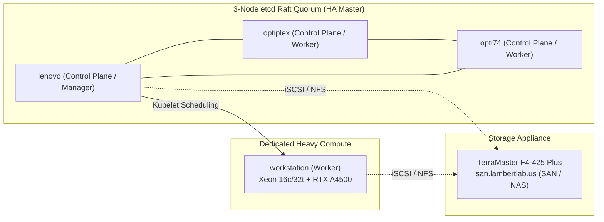

# Hardware Architecture & Cluster Topology

The **LambertLab** physical cluster balances high-availability Kubernetes control plane quorum with heavy GPU and SIEM compute.

---

## 🖥️ Physical Node Fleet

| Node Hostname | Hardware Model | CPU & Architecture | Memory | Storage Devices | Primary Responsibilities |
| :--- | :--- | :--- | :--- | :--- | :--- |
| **`lenovo`** | Lenovo ThinkCentre M700 | Intel Core i7-6700T (4c/8t @ 3.6 GHz) | 32 GB DDR4 | 128 GB SSD | Primary manager, etcd quorum member #1, local Traefik ingress, kubeadm control plane (kube-apiserver, kube-controller-manager, kube-scheduler, kube-vip) |
| **`optiplex`** | Dell OptiPlex 9020 | Intel Core i7-4770 (4c/8t @ 3.9 GHz) | 16 GB DDR3 | 250 GB SSD | etcd quorum member #2, Tailscale subnet router (Physical LAN & Overlay `10.10.0.0/24`) |
| **`opti74`** | Dell OptiPlex 7040 | Intel Core i7-6700 (4c/8t @ 4.0 GHz) | 32 GB DDR4 | 256 GB NVMe + 1 TB HDD | etcd quorum member #3, worker workloads, dedicated Palworld game server |
| **`workstation`** | Supermicro X10DAi | Dual Intel Xeon E5-2667 v4 (16c/32t @ 3.6 GHz) | 128 GB ECC | 256 GB NVMe + 500 GB SSD + 250 GB SSD | NVIDIA RTX A4500 (20GB VRAM), Kubernetes Elastic Stack (ECK: Elasticsearch, Logstash, Kibana), Docker GPU media compute |
| **TerraMaster NAS** | TerraMaster F4-425 Plus | Intel Quad-Core (`san.lambertlab.us`) | 8 GB | 4-Bay SATA SSD / HDD Array | Raw iSCSI target LUNs (VM boot disks) & 14TB bulk NFS pool |

---

## ⚖️ Control Plane High Availability & Stacked etcd Quorum

The Kubernetes cluster runs **upstream Kubernetes v1.37.1** bootstrapped with **kubeadm**, utilizing a stacked **`etcd` Raft consensus engine** and **`kube-vip`** control plane HA (virtual IP `10.0.0.201:6443`) distributed across the 3 control plane nodes:



### Fault Tolerance & Master Failover
* **Quorum Calculation:** A 3-node etcd cluster tolerates N = floor((3 - 1) / 2) = 1 node failure. If any single control plane node reboots, cluster state synchronization and API server operations remain uninterrupted.
* **Stacked Simplicity:** Stacked etcd runs dedicated etcd pods directly on the 3 control plane nodes co-located with kube-apiserver, maintaining Raft consensus without external database overhead.

---

## ⚡ Workstation Dual Role

`workstation` serves a dual purpose: it acts as a heavy Kubernetes worker node hosting the cluster's in-cluster **Elastic Stack** (Elasticsearch, Logstash, Fleet Server under the ECK Operator) bound to dedicated NVMe storage, while simultaneously hosting standalone GPU-accelerated Docker containers (Jellyfin transcoding, Tdarr pipelines) via its 20GB RTX A4500 GPU.

---

## 🔌 Remote Access & Node Management

Nodes are accessible via SSH and managed via Docker contexts:

```bash
# Direct SSH by hostname over LAN or Tailscale
ssh lenovo
ssh optiplex
ssh opti74
ssh workstation

# Multi-Node Docker Contexts (Managed from Lenovo)
docker --context default ps             # Local lenovo node
docker --context optiplex ps            # Optiplex 9020
docker --context opti74 ps              # Optiplex 7040
docker --context workstation-engine ps  # Workstation (GPU media containers)
```
