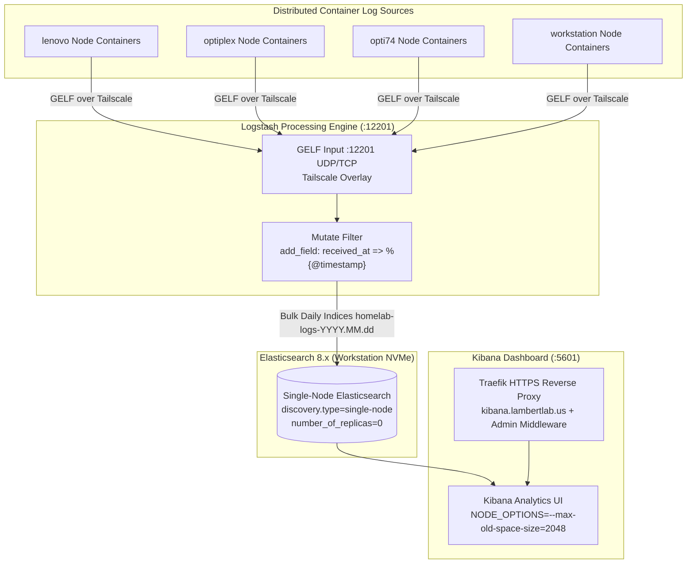

# Security Information & Event Management (SIEM) and Telemetry Architecture

Centralized log telemetry and security observability in **LambertLab** are powered by the **Elastic Stack** (ELK: Elasticsearch, Logstash, Kibana) acting as the centralized **Security Information and Event Management (SIEM)** platform, running on dedicated bare-metal host compute with high-speed local NVMe storage.

---

## 📊 Centralized Log Analytics & SIEM Pipeline



---

## 🔬 Elastic Stack Configuration & Compute Realities

Elasticsearch, Logstash, and Kibana are deployed to Kubernetes under the **ECK Operator** (`v3.5.0`) in the `observability` namespace (`kubernetes/observability/`), scheduled onto `workstation` to leverage its 16-core / 32-thread Xeon CPU and high-speed local NVMe storage:

### 1. Ingestion Protocol: Docker GELF over Tailscale (Port 12201 UDP/TCP)
Docker daemons across all cluster nodes stream container `stdout` and `stderr` directly to Logstash over the private Tailscale mesh network:
* **Zero Local Disk Wear:** Container logs stream over network buffers directly into Logstash, eliminating local disk log rotation wear across manager and worker nodes.
* **HostNetwork Binding:** Deployed with `hostNetwork: true` and `dnsPolicy: ClusterFirstWithHostNet` on `workstation`, allowing the GELF input to bind across all interfaces (specifically `tailscale0` at `100.106.96.18:12201`) without relying on hostPort routing.
* **Unified Pipeline:** Logstash tags incoming events with a `received_at` timestamp and indexes them directly into daily indices:
  ```ruby
  filter {
    mutate {
      add_field => { "received_at" => "%{@timestamp}" }
    }
  }
  ```

---

### 2. The Single-Node Index Lifecycle Management (ILM) Rule (`number_of_replicas: 0`)

In a homelab environment where Elasticsearch operates as a high-performance single-node instance:

!!! danger "Crucial Elasticsearch Cluster Health Rule"
    Elasticsearch defaults new indices to `number_of_replicas: 1`. In a single-node cluster (configured with `discovery.type=single-node`), there is only one node (`workstation`). Elasticsearch refuses to allocate a replica shard on the same physical node as the primary shard, leaving the replica permanently unassigned. Because the cluster cannot fulfill its replica policy, its health status degrades to **`YELLOW`**.
    
    When cluster status is Yellow, Elasticsearch **Index Lifecycle Management (ILM)** policies often pause or refuse to advance indices through Rollover, Warm, and Delete phases.
    
    **Requirement:** All index templates and ILM policies MUST explicitly enforce `number_of_replicas: 0`. This guarantees cluster health remains solid **`GREEN`**, ensuring automated rollover and storage pruning continue smoothly without human intervention.

```json
{
  "index": {
    "number_of_shards": 1,
    "number_of_replicas": 0,
    "refresh_interval": "5s"
  }
}
```

---

### 3. Storage Performance: NVMe Isolation vs Network iSCSI
Elasticsearch index operations generate heavy, unbuffered random read/write I/O patterns:
* **Architecture Constraint:** Elasticsearch index data (`/usr/share/elasticsearch/data`) **must never** reside on 1Gbps network iSCSI or NFS shares. Network storage latency introduces heavy write queuing, thread pool exhaustion (`write` queue rejection), and causes Kibana dashboards to time out.
* **Architecture:** In-cluster PersistentVolume `elasticsearch-data-pv` binds directly to local workstation NVMe SSD storage (`/home/chris/services/elasticsearch/data`) with `nodeAffinity` targeting `workstation`, delivering extreme random write IOPS with zero network jitter.

---

### 4. Kibana Memory Optimization
Kibana runs on Node.js. When executing deep time-range queries across millions of log entries, the default Node.js V8 heap limit can trigger Out-Of-Memory (OOM) fatal process crashes (`JavaScript heap out of memory`).

In `kubernetes/observability/kibana/kibana.yaml`, Kibana is provisioned under the ECK Operator with dedicated resource requests and limits:
```yaml
resources:
  requests:
    memory: 1.5Gi
    cpu: 500m
  limits:
    memory: 3Gi
    cpu: 2
```
Allocating a 3Gi memory limit ensures smooth visual aggregation and uninterrupted log exploration without container OOM kills.

---

### 5. Centralized Fleet Server & Elastic Agent DaemonSet

To capture container logs (`/var/log/pods`), cluster-level health, and bare-metal host OS telemetry (`journald`, `auth.log`, `syslog`) across all 4 nodes (`lenovo`, `optiplex`, `opti74`, `workstation`), the cluster utilizes **Elastic Fleet Server** and the official **Elastic Agent Helm Chart**:

* **Fleet Server (ECK Operator):**
  Deployed via ArgoCD (`kubernetes/apps/fleet-server.yaml`) as an ECK Agent CR (`kubernetes/observability/fleet-server/fleet-server.yaml`) in `mode: fleet` with native cluster scheduling. It connects directly to Elasticsearch and Kibana via internal cluster references and exposes its endpoint externally via Traefik Ingress at `https://fleet.lambertlab.us` with `default-insecure-transport`.
* **Fleet-Managed DaemonSet (`elastic-agent`):**
  Deployed via ArgoCD (`kubernetes/apps/elastic-agent.yaml`) utilizing the upstream Elastic Helm chart (`https://helm.elastic.co`, chart: `elastic-agent:9.5.6`).
  * **Pinned Image Tag:** Pinned to `9.3.2` to strictly adhere to Elastic's architectural requirement: $V_{\text{Agent}} \le V_{\text{Fleet Server}}$.
  * **System & Kubernetes Integrations:** With `system.enabled: true` and `preset: perNode`, exactly one agent pod runs on every cluster node, mounting `/var/log`, `/proc`, and `/sys` to monitor host OS telemetry and container logs simultaneously with zero duplication.
  * **Secret Decoupling:** Uses `tokenFromSecret` referencing Kubernetes secret `elastic-agent-token` in `kube-system`, synced from HashiCorp Vault via External Secrets Operator. Plaintext enrollment tokens are never committed to Git.
  * **Ingress Connectivity:** Configured with `url: "https://fleet.lambertlab.us"` so host-networked agents on all physical nodes route reliably through Traefik ingress without cross-node ClusterIP routing hurdles.
  * **Memory Sizing:** Resource limits configured with `memory: 2000Mi` in `kubernetes/observability/elastic-agent/values.yaml` to ensure agents do not encounter OOMKilled restarts during high-volume log bursts.
  * **Network & Firewall Syslog Ingestion (`elastic-agent-syslog`):** Exposed via a dedicated Kubernetes `LoadBalancer` Service (`kubernetes/observability/elastic-agent/service.yaml`) claiming static IP `10.0.0.210` from Cilium's `lan-pool`. Binds UDP and TCP on port `5514` to route incoming RFC 5424 syslog streams from edge firewalls (OPNsense) directly to the Elastic Agent DaemonSet for parsing into dedicated data stream `logs-pfsense.log-default`.

---

### 6. Elastic AutoOps Cloud Connect (Automated Cluster Monitoring)

To monitor cluster performance, shard allocation, and operational health against Elastic best practices, the cluster connects to **Elastic AutoOps Cloud**:
* **Deployment Model:** Deployed via ArgoCD (`kubernetes/apps/autoops.yaml`) utilizing Kustomize (`kubernetes/observability/autoops/kustomization.yaml`) which references Elastic's upstream deployment directly from `elastic/autoops-install` (`autoops_agent_deployment.yaml`) alongside an `ExternalSecret` managing `autoops-secret` from Vault.
* **Self-Healing Liveness Probe:** Applies a Kustomize patch adding a `livenessProbe` against `http://127.0.0.1:8888/metrics` (`libbeat_pipeline_clients{receiver="metricbeatreceiver"} [1-9]`) to verify the 9 embedded `autoops_es` Metricbeat input streams (`cat_shards`, `node_stats`, `tasks_management`, `cluster_health`, `cluster_settings`, `cat_template`, `component_template`, `index_template`, `license`) remain active and automatically restart the container if startup registration fails while Elasticsearch is restarting.

---

### 7. Integrated Dashboards & Discover Views

Homelab telemetry streams into the `logs-*` and `metrics-*` data views in Kibana (`https://kibana.lambertlab.us`). The platform provides a comprehensive suite of pre-built and custom-integrated dashboards across perimeter security, cluster performance, host hygiene, and directory services:

#### A. Curated Discover Views & Saved Searches

| View Name | Target Dataset / Filter | Primary Display Columns | Operational Purpose |
|:---|:---|:---|:---|
| **Firewall - ASN & Geo Egress Explorer** | `data_stream.dataset: "pfsense.log" and event.provider: "filterlog"` | `event.action`, `observer.ingress.interface.name`, `source.ip`, `destination.ip`, `destination.port`, `destination.as.organization.name`, `destination.geo.country_name` | Real-time SIEM inspection of outbound connections with automated ASN, Organization, and Geolocation resolution. |
| **Host Sudo Audit** | `data_stream.dataset: "system.auth" and process.name: "sudo"` | `host.hostname`, `process.name`, `system.auth.sudo.command`, `message` | Complete audit trail of elevated privileged commands across all cluster nodes. |
| **Failed SSH Logins** | `data_stream.dataset: "system.auth" and process.name: "sshd" and (message: ("Failed" or "Invalid") or system.auth.ssh.event: "Failed")` | `host.hostname`, `user.name`, `source.ip`, `message` | Detect brute-force attempts and unauthorized user logins with geographic mapping. |
| **Kernel OOM Killer** | `message: (*oom* or "Out of memory" or "invoked oom-killer" or "Killed process") or process.name: "kernel"` | `host.hostname`, `process.name`, `message` | Track memory starvation events and kernel kills across nodes. |
| **Systemd Unit Failures** | `message: ("Failed to start" or "Unit entered failed state" or "Failed with result")` | `host.hostname`, `process.name`, `message` | Identify host daemon crashes (`containerd`, `kubelet`, `docker`, `tailscale`). |
| **Pod CrashLoopBackOff** | `data_stream.dataset: "kubernetes.container_logs" and (log.level: ("error" or "fatal") or message: ("CrashLoopBackOff" or "panic:"))` | `kubernetes.namespace`, `kubernetes.pod.name`, `kubernetes.container.name`, `message` | Instant detection of crashing or restarting cluster workloads. |
| **Longhorn Storage Alerts** | `kubernetes.namespace: "longhorn-system" and (log.level: ("error" or "warning") or message: ("failed" or "degraded" or "timeout"))` | `kubernetes.pod.name`, `log.level`, `message` | Storage engine alerts, degraded replicas, and detachments. |
| **Traefik Ingress 5xx** | `kubernetes.namespace: "kube-system" and (message: (" 500 " or " 502 " or " 503 " or " 504 ") or log.level: "error")` | `kubernetes.pod.name`, `message` | Reverse proxy backend connection and gateway errors. |

#### B. Integrated Production Dashboards

* **Perimeter & Firewall Intelligence (`pfsense`):**
  * `Firewall - Dashboard [pfSense]`: Real-time allow/block distributions, transport protocol splits (TCP/UDP/ICMP), and geographic source/destination heatmaps.
  * `Unbound - Dashboard [pfSense]`: Recursive DNS resolver query latency, top requested domain names, query types (`A`, `AAAA`, `TXT`), and response codes.
  * `DHCP - Dashboard [pfSense]`: Dynamic lease pools, client MAC addresses, and IP allocation timelines.
* **Kubernetes Cluster & Storage Telemetry (`kube-state-metrics`):**
  * `[Metrics Kubernetes] Cluster Overview`: Global cluster capacity, CPU/memory saturation, and node readiness states.
  * `[Metrics Kubernetes] PV/PVC` & `[Metrics Kubernetes] Volumes`: Real-time storage consumption across Longhorn distributed volumes and local-path storage claims.
  * `[Metrics Kubernetes] Nodes` & `Pods`: Deep per-node kubelet memory pressure, CPU throttling rates, and container restart counters.
  * `[Metrics Kubernetes] API server` & `Controller Manager`: Control plane API request latency, queue depth, and admission webhook health.
* **Physical Host OS & Hardware Performance (`metrics-system.*`):**
  * `[Metrics System] Host overview`: Time-series metrics for physical nodes (`workstation`, `optiplex`, `opti74`, `opti76`, `lenovo`) tracking per-core CPU loads, memory buffer/cached ratios, network interface throughput (RX/TX), and disk IOPS.
* **Host Security & Administrative Auditing (`logs-system.*`):**
  * `[Logs System] Sudo commands`: Audit log tracking who executed `sudo`, the target binary, and execution exit codes.
  * `[Logs System] SSH login attempts`: Global geographic map of incoming SSH attempts and failed brute-force usernames.
  * `[Logs System] Syslog dashboard`: Aggregated systemd service crashes, kernel ring buffer events, and host reboot logs.
* **Active Directory & Identity Monitoring (`logs-system.*` / Windows Security):**
  * `[System Windows Security] User Logons`: Event ID 4624 logon monitoring, logon types (interactive vs network), and user session tracking.
  * `[System Windows Security] Failed and Blocked Accounts`: Event ID 4625 brute-force detection and account lockout alerts.
  * `[System Windows Security] User Management Events`: User account creation, modification, and deletion auditing (Event IDs 4720/4726/4738).
  * `[System Windows Security] Group Management Events`: Security group membership additions and domain administrative privilege escalations.


