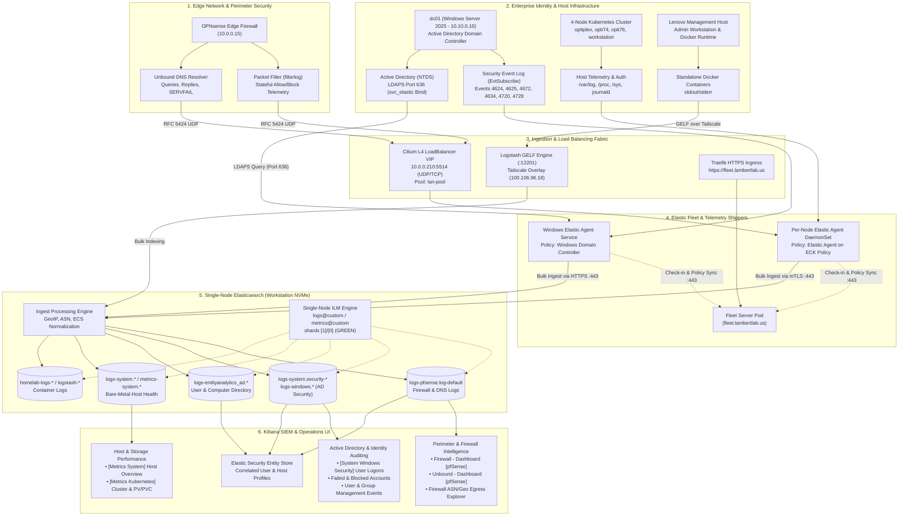
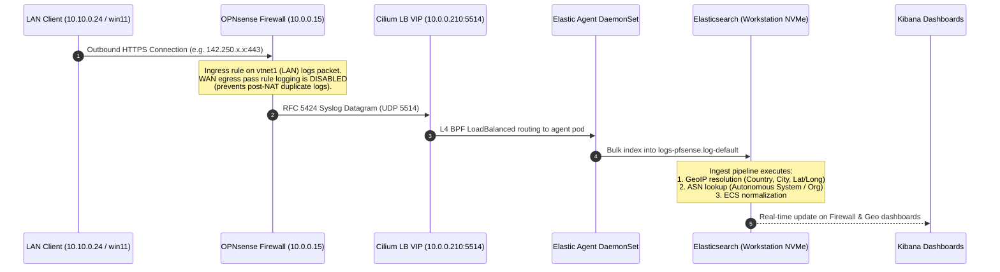
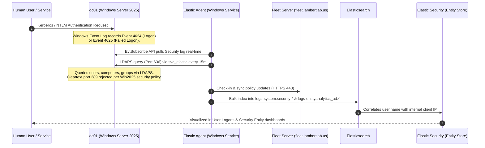

# Security Information & Event Management (SIEM) and Telemetry Architecture

Centralized security intelligence, log telemetry, and cluster observability in **LambertLab** are powered by the **Elastic Stack** (Elasticsearch, Kibana, Logstash, and Elastic Fleet) deployed on dedicated bare-metal compute under the **ECK Operator (`v3.5.0`)** with local high-speed NVMe storage on `workstation`.

The platform functions as a full-spectrum **Security Information and Event Management (SIEM)** fabric, correlating Layer 3/4 edge firewall flows and recursive DNS queries from OPNsense with enterprise Active Directory identity events from Windows Server 2025, Kubernetes container logs, and bare-metal host health.

---

## 📊 Global SIEM Telemetry & Analytics Fabric



---

## 🔬 Multi-Tier Telemetry Architecture

### Tier 1: Perimeter Firewall & DNS Telemetry (OPNsense)
Edge security telemetry is captured from **OPNsense** (`10.0.0.15`), streaming real-time network traffic and DNS query events without intermediate Logstash forwarders:



* **Cilium L4 LoadBalancer Ingress:** Exposed via a dedicated Kubernetes Service (`kubernetes/observability/elastic-agent/service.yaml`) claiming static LAN VIP `10.0.0.210` from Cilium's `lan-pool` on UDP/TCP port `5514`.
* **Stateful Firewall Logging (`filterlog`):** RFC 5424 structured syslog export capturing packet headers, ingress/egress interfaces (`vtnet0` WAN vs `vtnet1` LAN), source/destination IPs, transport protocols, and action decisions (Pass / Block).
* **NAT Duplicate Logging Prevention:** Logging is enabled strictly on LAN/VLAN ingress rules to capture true internal origin IPs (`10.10.0.10`, `10.10.0.24`), while general WAN outbound pass rules have logging disabled to prevent redundant post-NAT (`10.0.2.2`) records.
* **Recursive DNS Query Auditing (`unbound`):** Captures query and response telemetry (`Log Queries: ON`, `Log Replies: ON`, `Tag Queries: OFF`, `SERVFAIL: ON`) at Verbosity Level 1, extracting `dns.question.name`, `dns.question.type`, and return codes into Elastic Common Schema (ECS).
* **Detailed Runbook:** See the [OPNsense Firewall & Unbound DNS SIEM Integration Runbook](../runbooks/opnsense-elk-siem-integration.md).

---

### Tier 2: Enterprise Identity & Active Directory Auditing (`dc01`)
Security auditing on the Primary Domain Controller (`dc01`, Windows Server 2025 Datacenter at `10.10.0.10`) is collected natively via Elastic Agent running as an automated Windows Service:



* **Windows Event Log Ingestion (`EvtSubscribe`):** Ingests security events directly from the Windows kernel without third-party log-scraping agents. Key Event IDs monitored include:
  * **Event ID 4624:** Successful Logon (captures `TargetUserName`, `LogonType`, `WorkstationName`, and client `IpAddress`).
  * **Event ID 4625:** Failed Authentication / Brute-Force Detection.
  * **Event ID 4672:** Administrative Privilege Assignment (Domain Admins / Special Logons).
  * **Event ID 4634 / 4647:** User Logoff and Session Destruction.
  * **Event IDs 4720, 4726, 4738:** User Account Management (Creation, Deletion, Attribute modification).
  * **Event IDs 4728, 4732, 4756:** Privileged Security Group Membership tampering.
* **Active Directory Entity Analytics over Secure LDAPS:** Connects locally to `ldaps://dc01.ad.lambertlab.us:636` to index domain users, workstations, and security groups.
  * *Windows Server 2025 Hardening:* Enforces LDAPS on port 636; cleartext simple binds over port 389 are rejected by Windows Server 2025's hardened LDAP signing policies.
  * *Service Account:* Authenticates via dedicated read-only LDAP bind account `CN=svc_elastic,OU=Service Accounts,OU=LambertLab,DC=ad,DC=lambertlab,DC=us`, provisioned declaratively via Terraform and backed by HashiCorp Vault (`ad_svc_elastic_password`).
* **Detailed Runbook:** See the [Active Directory & Windows SIEM Integration Runbook](../runbooks/active-directory-siem-integration.md).

---

### Tier 3: Kubernetes Control Plane & Node Telemetry
* **Per-Node Elastic Agent DaemonSet:** Deployed via Helm chart `elastic-agent:9.5.6` (pinned image `9.3.2`) in `kubernetes/observability/elastic-agent/`.
* **Zero Container Log Duplication:** Mounts `/var/log`, `/proc`, and `/sys` across all 4 cluster nodes (`optiplex`, `opti74`, `opti76`, `workstation`), simultaneously capturing host kernel events, systemd unit failures, and container pod logs.
* **Cluster Metrics:** Embedded `kube-state-metrics` input monitors cluster CPU/memory allocation, Longhorn persistent volume capacity, API server request latencies, and pod restart loops.

---

### Tier 4: Management Host & Legacy Ingestion
* **Docker GELF over Tailscale (Port 12201 UDP/TCP):** The standalone management host (`lenovo`) runs administrative workloads and local Docker containers, streaming container `stdout`/`stderr` across the encrypted Tailscale mesh (`100.106.96.18:12201`) into ECK Logstash on `workstation`.
* **Zero Host Wear:** Networked log streaming avoids local disk rotation thrashing on solid-state drives.

---

## 🏛️ Centralized Fleet Policy Matrix

Elastic Agent configurations are managed centrally in Kibana via Fleet Agent Policies without editing configuration files on target hosts:

| Policy Name | Target Host / Workload | Associated Integrations | Output Destination |
| :--- | :--- | :--- | :--- |
| **`Elastic Agent on ECK Policy`** | 4-Node Kubernetes Cluster (`optiplex`, `opti74`, `opti76`, `workstation`) | • **`pfsense`**: Port `5514` UDP syslog input<br>• **`system`**: Host OS logs (`auth`, `syslog`) & metrics<br>• **`kubernetes`**: Pod container logs & `kube-state-metrics` | `elasticsearch` (In-Cluster ECK mTLS) |
| **`Windows - Active Directory Domain Controller Policy`** | `dc01` (Windows Server 2025 Datacenter - `10.10.0.10`) | • **`windows`**: Event logs (`Security`, `System`, `Application`)<br>• **`system`**: Windows system performance metrics<br>• **`entityanalytics_ad`**: LDAPS entity sync via `svc_elastic` | `elasticsearch` (Traefik Ingress HTTPS) |

---

## 💾 Storage & Lifecycle Engineering: The Single-Node ILM Invariant

Elasticsearch runs as a dedicated single-node instance on `workstation` local NVMe storage (`/home/chris/services/elasticsearch/data` bound via PV `elasticsearch-data-pv`).

!!! danger "Crucial Single-Node Elasticsearch Cluster Health Rule"
    In a single-node cluster (configured with `discovery.type=single-node`), Elasticsearch refuses to allocate replica shards on the same physical node as primary shards. If any index template specifies `number_of_replicas >= 1`, replica shards remain permanently unassigned and cluster health degrades to **`YELLOW`**.
    
    When cluster status is Yellow, Elasticsearch **Index Lifecycle Management (ILM)** pauses or refuses to advance indices from Hot to Warm, Cold, or Delete phases, eventually exhausting physical NVMe storage.
    
    **Homelab Invariant:** All data streams and index templates MUST explicitly enforce `number_of_replicas: 0` (`shards [1]/[0]`). This preserves solid **`GREEN`** cluster status and guarantees automated rollover, compression, and pruning operate without human intervention.

```json
{
  "index": {
    "number_of_shards": 1,
    "number_of_replicas": 0,
    "refresh_interval": "5s"
  }
}
```

### Automated Data Stream ILM Mapping
Every active data stream inherits `number_of_replicas: 0` and its assigned retention schedule through global `@custom` component templates:

| Data Stream Family | Matching Pattern | Assigned ILM Policy | Retention Schedule |
| :--- | :--- | :--- | :--- |
| **Edge Firewall & DNS** | `logs-pfsense.*` | `System-Logs-Reteniton-Policy` | Hot (1 day / 5 GB) → Warm (2 days) → Delete (3 days post-rollover) |
| **Active Directory Security** | `logs-system.security-*`, `logs-windows.*` | `System-Logs-Reteniton-Policy` | Hot (1 day / 5 GB) → Warm (2 days) → Delete (3 days post-rollover) |
| **Directory Entity State** | `logs-entityanalytics_ad.*` | `System-Logs-Reteniton-Policy` | Hot (1 day / 5 GB) → Warm (2 days) → Delete (3 days post-rollover) |
| **Host & Windows Metrics** | `metrics-system.*`, `metrics-windows.*` | `Metrics-Retention-Policy` | Hot (1 day / 5 GB) → Warm (2 days) → Delete (7 days post-rollover) |
| **Cluster Container Logs** | `logs-kubernetes.*`, `logstash-*` | `System-Logs-Reteniton-Policy` | Hot (1 day / 5 GB) → Warm (2 days) → Delete (3 days post-rollover) |

---

## 📈 Integrated SIEM Dashboards & Discover Views

Homelab telemetry streams into the `logs-*` and `metrics-*` data views in Kibana (`https://kibana.lambertlab.us`). The platform provides a curated suite of operational and security dashboards:

### 1. Curated Discover Views & Saved Searches

| View Name | Target Dataset / Filter | Primary Display Columns | Operational Purpose |
|:---|:---|:---|:---|
| **Firewall - ASN & Geo Egress Explorer** | `data_stream.dataset: "pfsense.log" and event.provider: "filterlog"` | `event.action`, `observer.ingress.interface.name`, `source.ip`, `destination.ip`, `destination.port`, `destination.as.organization.name`, `destination.geo.country_name` | Real-time SIEM inspection of outbound connections with automated ASN, Organization, and Geolocation resolution. |
| **Host Sudo Audit** | `data_stream.dataset: "system.auth" and process.name: "sudo"` | `host.hostname`, `process.name`, `system.auth.sudo.command`, `message` | Complete audit trail of elevated privileged commands across all cluster nodes. |
| **Failed SSH Logins** | `data_stream.dataset: "system.auth" and process.name: "sshd" and (message: ("Failed" or "Invalid") or system.auth.ssh.event: "Failed")` | `host.hostname`, `user.name`, `source.ip`, `message` | Detect brute-force attempts and unauthorized user logins with geographic mapping. |
| **Kernel OOM Killer** | `message: (*oom* or "Out of memory" or "invoked oom-killer" or "Killed process") or process.name: "kernel"` | `host.hostname`, `process.name`, `message` | Track memory starvation events and kernel kills across nodes. |
| **Systemd Unit Failures** | `message: ("Failed to start" or "Unit entered failed state" or "Failed with result")` | `host.hostname`, `process.name`, `message` | Identify host daemon crashes (`containerd`, `kubelet`, `docker`, `tailscale`). |
| **Pod CrashLoopBackOff** | `data_stream.dataset: "kubernetes.container_logs" and (log.level: ("error" or "fatal") or message: ("CrashLoopBackOff" or "panic:"))` | `kubernetes.namespace`, `kubernetes.pod.name`, `kubernetes.container.name`, `message` | Instant detection of crashing or restarting cluster workloads. |

---

### 2. Integrated Production Dashboards

* **Perimeter & Network Intelligence (`pfsense`):**
  * `Firewall - Dashboard [pfSense]`: Real-time allow/block distributions, transport protocol splits (TCP/UDP/ICMP), and geographic source/destination heatmaps.
  * `Unbound - Dashboard [pfSense]`: Recursive DNS resolver query latency, top requested domain names, query types (`A`, `AAAA`, `TXT`), and response codes.
  * `DHCP - Dashboard [pfSense]`: Dynamic lease allocations and hardware MAC address mapping.
* **Active Directory & Identity Intelligence (Windows Server 2025):**
  * `[System Windows Security] User Logons`: Event ID 4624 logon monitoring, interactive vs network logon types, authenticating workstations, and user session timelines.
  * `[System Windows Security] Failed and Blocked Accounts`: Event ID 4625 brute-force detection, bad passwords, and account lockout alerts.
  * `[System Windows Security] User Management Events`: User account creation, modification, and deletion auditing (Event IDs 4720, 4726, 4738).
  * `[System Windows Security] Group Management Events`: Security group membership additions and domain administrative privilege escalations (Event IDs 4728, 4732).
  * `[Logs System Windows Security] Directory & Account Monitoring`: Privileged logon tracking, Kerberos TGT/TGS ticket requests, and domain security changes.
* **Kubernetes Cluster & Storage Telemetry (`kube-state-metrics`):**
  * `[Metrics Kubernetes] Cluster Overview`: Global cluster capacity, CPU/memory saturation, and node readiness states.
  * `[Metrics Kubernetes] PV/PVC` & `[Metrics Kubernetes] Volumes`: Real-time storage consumption across Longhorn distributed volumes and local-path storage claims.
  * `[Metrics Kubernetes] Nodes` & `Pods`: Deep per-node kubelet memory pressure, CPU throttling rates, and container restart counters.
* **Physical Host OS & Hardware Performance (`metrics-system.*`):**
  * `[Metrics System] Host overview`: Time-series metrics for physical nodes (`workstation`, `optiplex`, `opti74`, `opti76`, `dc01`) tracking CPU loads, memory buffer/cached ratios, network interface throughput (RX/TX), and disk IOPS.
