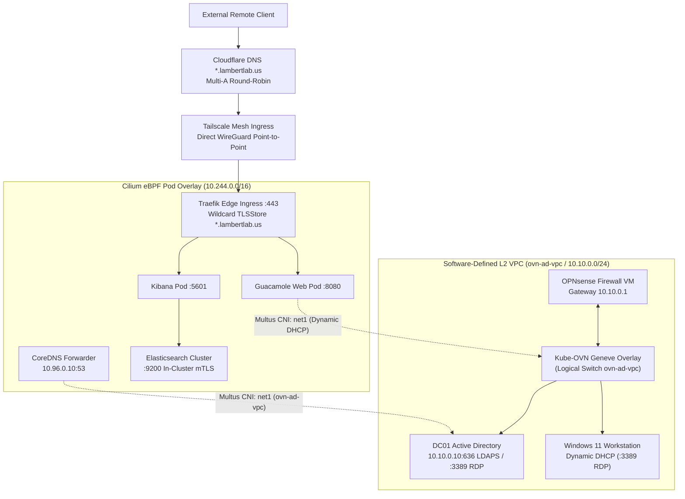
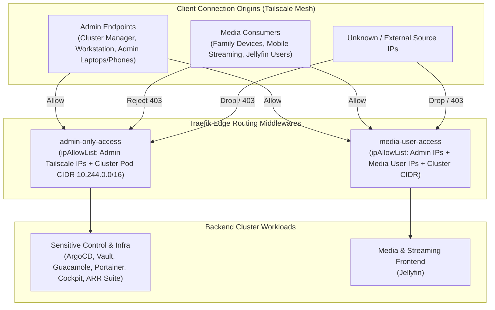

# Software-Defined L2 VPC & CoreDNS Architecture

The **LambertLab** network combines software-defined Layer 2 Geneve VPC tunneling via **Kube-OVN**, conditional Active Directory DNS forwarding over Multus, hardware NIC offload tuning, and multi-cloud edge ingress.

---

## 🌐 Network Topology Overview



---

## 🚪 Edge Ingress & Tailscale Round-Robin

External access to cluster services is secured without exposing public listening ports or relying on dynamic DNS port-forwarding:

1. **Cloudflare Multi-A Round-Robin:** `cloudflare.tf` maintains wildcard DNS records (`*.lambertlab.us`) resolving to the Tailscale IPv4 addresses of physical nodes (`opti74`, `opti76`, `optiplex`, `workstation`).
2. **Client IP Preservation:** Because traffic terminates directly on nodes via Tailscale WireGuard sockets rather than traversing an intermediate SNAT gateway proxy, original client IP addresses are preserved for Traefik security middlewares.
3. **Traefik Default TLSStore:** Cert-Manager issues a single wildcard certificate (`*.lambertlab.us`) via Cloudflare DNS-01 challenges stored in `kube-system`. Traefik automatically references this certificate across all Ingress and IngressRoute resources:

```yaml
# kubernetes/config/tls-store.yaml
apiVersion: traefik.io/v1alpha1
kind: TLSStore
metadata:
  name: default
  namespace: kube-system
spec:
  defaultCertificate:
    secretName: wildcard-lambertlab-us-tls
```

---

## 🛡️ Two-Tier Zero-Trust Ingress Filtering (Traefik Middlewares)

Cluster Ingress resources do not rely solely on application passwords or SSO; Traefik enforces network-level isolation using declarative `Middleware` resources (`kubernetes/config/access-control-list-middleware.yaml`) that inspect client source IP addresses before requests ever touch upstream application pods:



### 1. `admin-only-access` (Tier 1: Administrative Protection)
* **Scope:** Applied across all sensitive infrastructure, GitOps, virtualization, secrets, and management ingresses (`argocd`, `vault`, `guacamole`, `portainer`, `cockpit`, `code-server`, `nas`, `firefox`, `sonarr`, `radarr`, `prowlarr`).
* **Source Allowlist:**
  * Dedicated physical node endpoints (`opti74`, `opti76`, `optiplex`, `workstation`, and management host `lenovo`).
  * Primary administrative portable devices (laptops and administrative mobile clients).
  * In-cluster CNI pod network (`10.244.0.0/16`) to preserve internal service-to-service hairpinned routing.
  * Localhost loopback (`127.0.0.1/32`).
* **Result:** Even if an ingress endpoint URL is known or discovered, unauthorized requests receive an immediate HTTP 403 Forbidden at the Traefik proxy edge.

### 2. `media-user-access` (Tier 2: Scoped Consumer Access)
* **Scope:** Applied exclusively to end-user facing media portals (such as Jellyfin streaming).
* **Source Allowlist:**
  * All administrative endpoints from Tier 1.
  * Designated family and media client devices connected to the Tailscale mesh.
  * Internal cluster CNI and dashboard endpoints.
* **Result:** Grants media streaming access to trusted family clients while completely blocking them from querying administrative tools, databases, or cluster control planes.

---

## 🌉 Kube-OVN Software-Defined L2 VPC (`ovn-ad-vpc`)

The cluster utilizes **Kube-OVN** as a powerful Software-Defined Networking (SDN) overlay, replacing the legacy `br-lab0` NMState Linux bridge. Kube-OVN builds on top of Open vSwitch (OVS) and OVN to provide advanced enterprise features—such as isolated Virtual Private Clouds (VPCs), distributed routing, embedded IP Address Management (IPAM), and strict Layer-2 isolation—directly within Kubernetes.

By leveraging Geneve UDP encapsulation, Kube-OVN abstracts the physical network topology. This ensures seamless Layer 2 broadcast domains even across tricky underlay environments (such as Wi-Fi networks which typically drop foreign MACs and multicast frames).

* **VPC Name:** `ovn-cluster` (Logical Router) -> `ovn-ad-vpc` (Logical Switch)
* **Subnet CIDR:** `10.10.0.0/24`
* **OPNsense Gateway IP:** `10.10.0.1`
* **High Availability Architecture:** 3-node OVSDB Raft cluster (`ovn-central` and `kube-ovn-controller`) synchronized across control-plane nodes (`opti74`, `opti76`, `optiplex`).

### Why We Migrated from NMState `br-lab0`
Previously, the cluster relied on a multicast VXLAN overlay (`br-lab0`) managed declaratively by NMState (NetworkManager State). 
While NMState is great for declarative host networking, it heavily manipulates host `iptables` and binds virtual bridges directly to physical host interfaces. Kube-OVN is a much better implementation for Kubernetes because it utilizes a pure Software-Defined Geneve overlay that is completely decoupled from host routing rules and physical network quirks (like Wi-Fi access points aggressively dropping foreign MACs). Additionally, Kube-OVN provides native IP Address Management (IPAM) for seamless DHCP, eliminating the need to manually track static IPs across virtual bridges.

### Multus CNI Secondary Interface Attachment
Standard Kubernetes pods receive a Cilium overlay IP (`10.244.x.x`). Cilium is configured with `cni.exclusive: false` (in `kubernetes/infrastructure/network/cilium/values.yaml`) so it does not strip Multus CNI manifests from `/etc/cni/net.d/`, while Kube-OVN runs exclusively as a secondary CNI (`nonPrimaryCNI: true`) with configuration priority set to `10` (`configPriority: "10"` in `kubernetes/infrastructure/network/kube-ovn/values.yaml`). This ensures that Multus CNI auto-discovery (`00-multus.conf`) always prioritizes Cilium's `05-cilium.conflist` over Kube-OVN's `10-kube-ovn.conflist` for the default `eth0` network interface.

Using **Multus CNI**, select pods (like Apache Guacamole and CoreDNS) are provisioned with a secondary interface (`net1`) plugged directly into the Kube-OVN `ovn-ad-vpc` VPC. Because the Kube-OVN provider suffix ends in `.ovn`, Kube-OVN intercepts the Multus attachment and executes IPAM allocation.

```yaml
# Pod Annotation on Guacamole Deployment (Dynamic DHCP)
k8s.v1.cni.cncf.io/networks: vms/ovn-ad-vpc
```

```yaml
# Pod Annotation for VM or CoreDNS (Static IP Allocation)
k8s.v1.cni.cncf.io/networks: vms/ovn-ad-vpc
ovn-ad-vpc.vms.ovn.kubernetes.io/ip_address: 10.10.0.10
```

[Read more about Kube-OVN Advanced Subnets & Multus IPAM here](https://kubeovn.github.io/docs/stable/en/advance/multi-nic/).

### CoreDNS Integration into the VPC
Because OVN VPCs are completely isolated Layer-2 broadcast domains with strict security, standard Pods cannot reach them by default. 
To enable the cluster to resolve Active Directory queries (`dc01.ad.lambertlab.us`), the `coredns` deployment in `kube-system` is patched to attach a secondary Multus interface directly to `ovn-ad-vpc`. This gives CoreDNS a secure, direct path to forward DNS queries to `10.10.0.10`.

---

## 🔍 CoreDNS Conditional Forwarding to Active Directory

Kubernetes pods routinely need to resolve domain-joined machines like `dc01.ad.lambertlab.us` or `win11-01.ad.lambertlab.us`.

Because Windows clients update their DNS dynamically via Active Directory Dynamic DNS (DDNS), cluster CoreDNS forwarders are configured with **active health checking**:

```yaml
# kubernetes/config/coredns.yaml
ad.lambertlab.us:53 {
    forward . 10.10.0.10 {
        health_check 5s
        max_fails 2
    }
    cache 30
    reload
}
```

### Why Health-Checking is Essential
Without `health_check 5s` and `max_fails 2`, if DC01 reboots or a worker node faces transient network latency, CoreDNS pods hang waiting on UDP timeouts (30+ seconds), stalling applications across the cluster. With active health-checks, degraded upstream forwarders fail fast (< 5s) and seamlessly route to healthy replicas.

---

## 🌐 Split-Horizon Ingress Resolution for Cluster Workloads (*.lambertlab.us)

When pods inside the Kubernetes cluster query internal services hosted under the homelab domain (such as `kibana.lambertlab.us`, `vault.lambertlab.us`, `fleet.lambertlab.us`, or `argocd.lambertlab.us`), standard public DNS resolution loops out to Cloudflare external nameservers and hairpins across Tailscale round-robin mesh addresses (`100.x.x.x`). 

This hairpinning introduces:
1. **Unnecessary Latency & Network Overhead:** Packet traversal through public upstream nameservers and TLS connection renegotiation across wide-area overlays.
2. **External Dependency:** In-cluster microservice and observability communication fails if upstream internet or public DNS resolution faces transient disruptions.

### Dynamic In-Cluster Ingress Resolution via CoreDNS Template
To eliminate hairpinning without hardcoding internal ClusterIPs, CoreDNS dynamically aliases all subdomain queries under `lambertlab.us` to Traefik's in-cluster service using the **`template` plugin**:

```corefile
# kubernetes/config/coredns/coredns.yaml
template IN ANY lambertlab.us {
    match "^(?P<host>[a-zA-Z0-9-_]+)\.lambertlab\.us\.$"
    answer "{{ .Name }} 30 IN CNAME traefik.kube-system.svc.cluster.local."
    fallthrough
}
```

```mermaid
flowchart LR
    subgraph Hairpin["Hairpinned Path (Legacy / External)"]
        direction TB
        P1["Pod / OPNsense WAN"] -->|1. External Query| CF["Cloudflare DNS"]
        CF -->|2. Returns 100.x.x.x| P1
        P1 -->|3. Egress tailscale0| TS["Tailscale WireGuard"]
        TS -->|4. Loopback Re-Entry| T1["Traefik Ingress (:443)"]
        T1 --> Target1["Target Service (e.g. Vault)"]
    end

    subgraph Direct["Split-Horizon Path (CoreDNS Template)"]
        direction TB
        P2["Pod / OPNsense WAN"] -->|1. Internal Query| CD["CoreDNS Template"]
        CD -->|2. Dynamic CNAME (30s TTL)| T2["Traefik ClusterIP"]
        P2 -->|3. Direct In-Cluster TCP| T2
        T2 --> Target2["Target Service (e.g. Vault)"]
    end
```

#### Directive Breakdown
* **`template IN ANY lambertlab.us`**: Scopes dynamic response generation to the `lambertlab.us` domain for all query types (`A` and `AAAA`), leaving external and reverse DNS untouched.
* **`match "^(?P<host>[a-zA-Z0-9-_]+)\.lambertlab\.us\.$"`**: Regex filter strictly matching one-level subdomains (such as `kibana`, `vault`, `fleet`, `winrm`).
* **`answer "{{ .Name }} 30 IN CNAME traefik.kube-system.svc.cluster.local."`**: Rewrites the query to an alias (CNAME) pointing to Traefik's internal Kubernetes service with a **30-second TTL**, matching the cluster's standard `kubernetes` service discovery and cache TTL.
* **`fallthrough`**: Passes any non-matching queries gracefully down the CoreDNS plugin chain to upstream forwarders.

### Architectural Invariants & Dynamic Service Discovery
* **Zero Hardcoded IPs (Reinstall-Resilient):** Because the record aliases `traefik.kube-system.svc.cluster.local`, CoreDNS's live API watcher (`kubernetes` plugin) resolves Traefik's live ClusterIP dynamically. If Traefik is redeployed or assigned a new IP, DNS immediately auto-heals.
* **Preservation of Active Directory DDNS (`ad.lambertlab.us`):** Per CoreDNS specifications, server blocks evaluate queries by **longest suffix match**. The dedicated `ad.lambertlab.us:53` server block (3 domain labels) maintains 100% priority over the root `.:53` block (0 labels), routing all Active Directory queries (`dc01.ad.lambertlab.us`, `win11-01.ad.lambertlab.us`) over the Multus VPC directly to DC01 (`10.10.0.10`).
* **Traefik Ingress SNI Routing:** When internal pods connect to Traefik on port 443, Traefik inspects the TLS Server Name Indication (SNI) and HTTP `Host` headers, routing directly to target workloads (`kibana`, `vault`, `fleet`) in sub-millisecond latency.

---

## ⚡ Intel I219-LM NIC Hardware Offload Optimization

Worker nodes utilizing Intel I219-LM Ethernet controllers (`optiplex` and `opti74`) running the Linux `e1000e` kernel driver can experience sporadic hardware micro-hangs and watchdog resets (`e1000e: Detected Hardware Unit Hang`) during sustained Gigabit packet bursts.

To eliminate driver lockups, an Ansible automation playbook applies deterministic `ethtool` offload adjustments during boot:

```yaml
- name: Disable problematic hardware offloads on I219-LM
  ansible.builtin.command:
    cmd: ethtool -K {{ ansible_default_ipv4.interface }} rx off tx off tso off gso off
```

Disabling TCP segmentation offload (TSO) and generic segmentation offload (GSO) offloads packet framing to the Linux kernel network stack, completely eliminating hardware controller state corruption.

---

## 🔄 Internal VM Hairpin Routing & WAN Masquerade

KubeVirt virtual machines (such as `dc01` and `win11-01`) reside on the `10.10.0.0/24` Kube-OVN Geneve VPC subnet and do not run Tailscale clients. 

* **OPNsense WAN Masquerade (`interfaces.masquerade: {}`):** The OPNsense firewall VM operates with its primary WAN interface plugged directly into the standard Kubernetes Pod network (`pod: {}`). Outbound VM traffic destined for external networks is SNAT'd/masqueraded by KubeVirt directly into the host pod network on `workstation`.
* **Legacy Tailscale Hairpin:** Prior to split-horizon DNS, when VMs resolved `*.lambertlab.us`, upstream DNS returned the Cloudflare Tailscale CGNAT address (`100.64.0.0/10`). Traffic exited OPNsense WAN into the host network, hit the node's `tailscale0` WireGuard adapter, and looped back into Traefik.
* **Traefik Middleware Exemption:** To prevent Traefik's IP allowlist middleware from dropping this loopback traffic, `10.244.0.0/16` and the VM VPC subnet are explicitly allowed in `kubernetes/config/traefik/access-control-list-middleware.yaml`.
* **Split-Horizon Optimization:** With CoreDNS dynamic templating in place, upstream DNS queries originating from the cluster and forwarded via OPNsense resolve directly to Traefik's internal Kubernetes ClusterIP, eliminating the `tailscale0` hairpin entirely.

---

## 🛡️ Zero-Trust Network Policies (Microsegmentation)

To prevent lateral movement across the cluster in the event of a compromised container (e.g., a zero-day in a media application or dashboard), the cluster implements strict **Zero-Trust Network Policies** across all core application namespaces (`media`, `guacamole`, `observability`, `gaming`, `external-secrets`).

### The Universal Default-Deny Baseline

Each protected namespace enforces a strict Default-Deny Ingress policy that blocks all incoming traffic with standard exceptions:
1. **Intra-Namespace Communication:** Pods within the same namespace are allowed to communicate freely (e.g., Guacamole frontend communicating with Guacamole PostgreSQL, or Radarr querying Sonarr).
2. **Traefik Ingress Controller:** Traffic originating from the `kube-system` namespace (which houses Traefik and cluster LoadBalancers) is explicitly allowed. This ensures external traffic routed via Ingress or UDP LoadBalancer reaches the pods successfully.
3. **Admission Webhooks (Targeted Ingress):** Workloads running Kubernetes admission webhooks (e.g., External Secrets Operator webhook on containerPort `10250` and ECK Elastic Operator webhook on containerPort `9443`) declare targeted NetworkPolicies matching their specific pod label and containerPort to permit control-plane API server validation requests. Because the Kubernetes control-plane API server operates on host networking outside pod selectors, traffic is permitted by destination port, with Layer 7 authentication enforced by mutual TLS (mTLS) with the cluster CA.

This architecture entirely drops unauthorized cross-namespace requests at the kernel firewall level (enforced by Cilium eBPF network policies).

### Centralized GitOps Governance
All Network Policies are decoupled from their individual application Helm charts and are instead stored centrally in the `kubernetes/network-policies` directory. A dedicated ArgoCD Application (`network-policies.yaml`) pinned to **Sync Wave 1** enforces these firewalls across the cluster globally before any application workloads are deployed in later sync waves (Waves 6–8).
