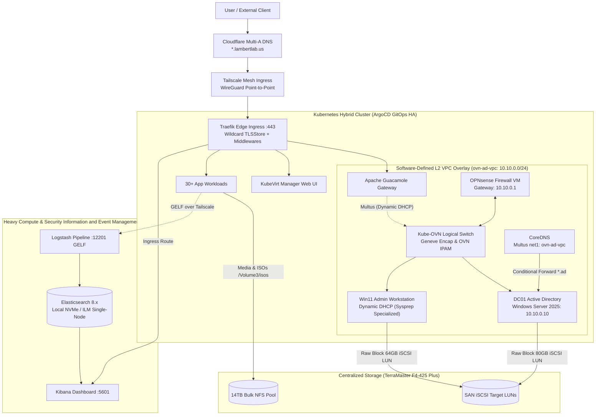

# LambertLab Infrastructure Documentation

Welcome to the central technical documentation and operational engineering knowledge base for the **LambertLab** hybrid cloud-native infrastructure.

---

## 🚀 Core Architectural Highlights

**LambertLab** operates as a bare-metal, high-availability Kubernetes cluster running upstream vanilla **Kubernetes v1.37.1**. While initially bootstrapped as a lightweight K3s distribution during early platform iterations, the infrastructure was subsequently reconstructed into an enterprise-grade pure vanilla Kubernetes cluster initialized and joined via **`kubeadm`**.

The cluster topology is engineered around clean, modular infrastructure layers:

- **Control Plane Quorum & Virtual IP:** Stacked **etcd** consensus distributed across a 3-node control plane quorum (`lenovo`, `optiplex`, `opti74`) with **`kube-vip`** providing virtual IP failover (`10.0.0.201:6443`).
- **Primary eBPF CNI & Routing:** **Cilium** running in pure eBPF mode, replacing `kube-proxy` for high-throughput pod routing, kernel-level network policies, and Layer 2 service IP announcement pools (`10.0.0.202-215`).
- **Edge Ingress Controller:** **Traefik** deployed as a cluster-wide DaemonSet handling HTTP/HTTPS edge ingress with automated wildcard TLS (`*.lambertlab.us`) and two-tier zero-trust IP allowlisting middlewares.
- **Secondary Virtualization CNI:** **Kube-OVN** operating via **Multus** meta-CNI as a dedicated secondary network, providing an isolated Software-Defined Layer 2 Geneve overlay VPC (`ovn-ad-vpc`, `10.10.0.0/24`) for KubeVirt virtual machines and dual-homed containers.
- **Multi-Tiered Storage Engine:** Distributed block storage with synchronous replication via **Longhorn**, lightweight node storage via **Local Path Provisioner**, low-latency SAN block storage via **TerraMaster iSCSI LUNs**, and bulk media via **NFS**.
- **Cluster Diagnostics & Acceleration:** In-cluster **Metrics Server** enabling resource tracking and `kubectl top` CLI commands, hardware GPU pass-through via the **NVIDIA GPU Operator**, and centralized logging via the **Elastic Stack** with **Elastic Agent**.

*(For the complete visual layout of the control plane, storage, SDN VPC, and ingress data paths, see the [Architecture Topology Diagram](#architecture-topology) at the bottom of this page).*

=== "GitOps & Multi-Tier Storage"
    - **High-Availability GitOps:** ArgoCD HA with Redis Sentinel, controller sharding, and dedicated AppProjects reconciling 40+ services across deterministic synchronization waves (0 to 9).
    - **Multi-Tiered Storage Matrix:** Dedicated TerraMaster SAN iSCSI block LUNs for low-latency VM disks, distributed Longhorn block storage with synchronous cross-node replication for databases, 14TB high-capacity NFS pools for bulk media, and dedicated local NVMe storage for real-time SIEM indexing.

=== "Hybrid Identity & Remote Access"
    - **Dual Directory Model:** Seamless identity federation combining on-premises Active Directory (`ad.lambertlab.us`, NetBIOS `LAMBERTLAB`) with Microsoft Entra ID.
    - **Entra Cloud Sync:** Zero-touch Password Hash Synchronization (PHS) running under an Active Directory Group Managed Service Account (`provAgentgMSA$`).
    - **Clientless Remote Gateway:** Apache Guacamole provides browser-based HTML5 RDP/SSH access with Entra ID OIDC SSO, on-premises LDAPS authentication with custom Root CA JVM truststore injection, and native Multus secondary pod networking directly into the Kube-OVN VPC.

=== "Software-Defined Networking"
    - **Kube-OVN Software-Defined L2 VPC (`ovn-ad-vpc`):** Enterprise SDN overlay powered by Geneve UDP encapsulation, decoupling virtual machine Layer 2 broadcast domains from host network interfaces and physical Wi-Fi restrictions.
    - **Direct Pod Bridging (Multus CNI):** Apache Guacamole pod attaches a secondary interface (`net1`) directly into `ovn-ad-vpc` with dynamic DHCP allocation, communicating with domain controllers and desktops at wire speed with zero NAT overhead.
    - **CoreDNS Direct VPC Integration:** In-cluster CoreDNS attaches a secondary Multus interface (`vms/ovn-ad-vpc`) directly into the VPC, conditionally routing `*.ad.lambertlab.us` to DC01 (`10.10.0.10`) with automated health checks (`health_check 5s`, `max_fails 2`).
    - **Subnet IPAM Quirk Mitigation:** Subnet manifest declares a dummy gateway (`10.10.0.254`), preventing Kube-OVN's mutating webhook from reserving and excluding `10.10.0.1`, allowing the virtualized OPNsense firewall to claim the `.1` gateway IP.

=== "Virtualization (KubeVirt)"
    - **Bare-Metal Virtualization:** High-performance Windows Server 2025 and Windows 11 Enterprise LTSC virtual machines managed natively alongside containerized microservices via KubeVirt v1.9.0.
    - **Hardware-Enforced Security:** OVMF UEFI Secure Boot paired with persistent virtual TPM 2.0 (`swtpm`) state volumes backed by Longhorn.
    - **Direct Line-Rate iSCSI Flashing:** Template images are converted directly from compressed QCOW2 into raw iSCSI block LUNs via `qemu-img convert` (`libiscsi`), completely bypassing HTTP ingress proxy idle timeouts and Longhorn 64GB scratch volume overhead.
    - **Automated Sysprep Specialization:** Dynamic `WIN-*` machine naming, zero-touch OOBE regional bypass, and least-privilege domain join automation via declarative `unattend.xml` answer files.

=== "Security Information and Event Management (SIEM) & Telemetry"
    - **Centralized Log Ingestion (Elastic Stack):** Cross-node Docker container logs streamed directly to Logstash in the Elastic Stack (ELK: Elasticsearch, Logstash, Kibana) via Docker GELF drivers over Tailscale on port 12201.
    - **Strict Index Lifecycle Management (ILM) Retention Rule:** Single-node Elasticsearch configurations enforce `number_of_replicas: 0` across index templates to ensure green cluster health and prevent automated ILM rollover and pruning stalls.
    - **Workstation Compute Isolation:** Strict memory and CPU resource caps (`guacd` capped at 2 cores) preserve 30 Xeon threads and 20GB RTX compute for real-time Elasticsearch pipelines and machine learning workloads.

---

## 📖 Complete Documentation Index

### 🏛️ Architecture Deep-Dives
- [Hardware Architecture & Fleet Topology](architecture/hardware.md): Node hardware specifications, 3-node etcd Raft quorum, and fleet topology.
- [Software-Defined L2 VPC & CoreDNS Fabric](architecture/networking.md): Kube-OVN Geneve overlay, Multus pod attachment, and CoreDNS health-checked forwarders.
- [Storage Hierarchy & SAN Architecture](architecture/storage.md): When and why to use SAN iSCSI vs Longhorn vs NFS vs local NVMe.
- [Hybrid Identity & Entra ID Federation](architecture/identity.md): Dual-directory identity, Cloud Sync gMSA, PHS, and RBAC security groups.
- [Apache Guacamole Gateway](architecture/guacamole.md): Clientless remote desktop, LDAPS Root CA JVM truststore injection, and OIDC SSO.
- [KubeVirt & Virtual Machine Lifecycle](architecture/virtualization.md): Bare-metal virtualization, Hyper-V enlightenments, Sysprep automation, and direct iSCSI flashing.
- [GitOps Engine & Synchronization Waves](architecture/gitops.md): ArgoCD HA architecture, AppProjects, sync wave topology, and self-healing.
- [Security Information and Event Management (SIEM) & Telemetry](architecture/logging.md): Centralized Elastic Stack (ELK: Elasticsearch, Logstash, Kibana), Docker GELF over Tailscale, local NVMe isolation, and single-node Index Lifecycle Management (ILM) policies.

### 📦 Application Service Catalog
- [Catalog Overview & Master Matrix](catalog/index.md): Complete directory, cluster namespaces, Docker contexts, and ingress endpoints.
- [Core Infrastructure & Networking](catalog/infrastructure.md): ArgoCD, Traefik, Cert-Manager, Kube-OVN, Multus, CoreDNS, Tailscale, Longhorn, KubeVirt, and TerraMaster TOS.
- [Virtual Machines & Identity](catalog/workstations-vms.md): DC01, Windows 11 Workstation, OPNsense Gateway, KubeVirt Manager, and Apache Guacamole.
- [Media & Home Automation](catalog/media-automation.md): Jellyfin, Sonarr, Radarr, Prowlarr, Tdarr, and Palworld Dedicated Server.
- [Security & Productivity Tools](catalog/security-tools.md): HashiCorp Vault, External Secrets, Elastic Stack (ELK: Elasticsearch, Logstash, Kibana), Homarr, Ntfy, Beszel, Pi-hole, Portainer, Firefox Sandbox, and developer tools.

### 🛠️ Operational Runbooks
- [Bridge Self-Healing Watchdog (Legacy)](runbooks/bridge-watchdog.md): Background, diagnosis, and automated recovery for USB NIC boot latency on `br-lab0`.
- [Direct iSCSI Line-Rate Flashing](runbooks/iscsi-flashing.md): Step-by-step user-space `qemu-img convert` flashing guide bypassing CDI and ingress timeouts.
- [Elastic Stack & Index Lifecycle Management (ILM) Maintenance](runbooks/elk-ilm-maintenance.md): Managing single-node index templates, troubleshooting unassigned replica shards, and testing GELF pipelines.
- [Disaster Recovery & Cluster Quorum](runbooks/disaster-recovery.md): Host reboot sequence, etcd Raft recovery, KubeVirt VM restoration, and break-glass administrative procedures.

---

## ⚡ Architecture Topology

