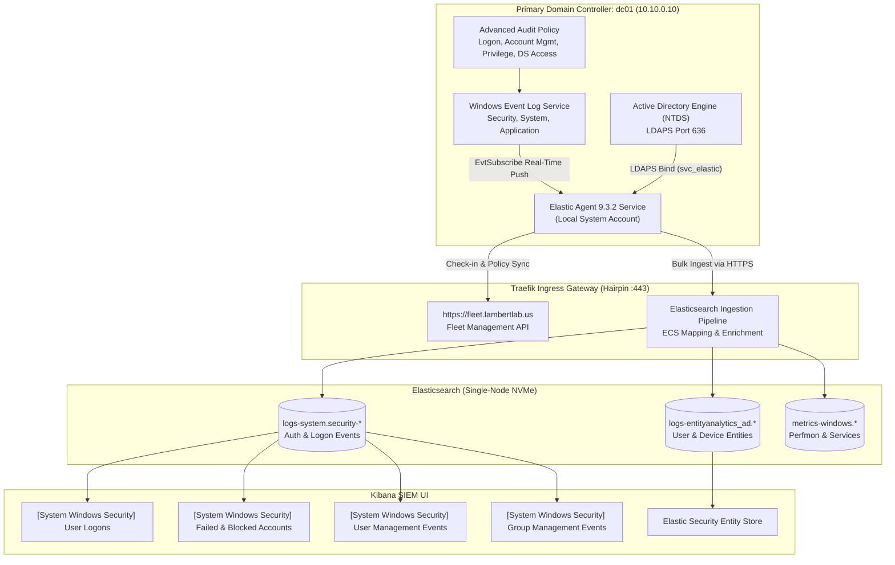

# Runbook: Active Directory & Windows Server 2025 SIEM Telemetry Integration

This runbook documents the complete end-to-end integration and configuration of **Active Directory Domain Services (AD DS)** security telemetry on **Windows Server 2025 Datacenter** (`dc01`) into the **LambertLab** centralized Elastic Stack (SIEM) using Elastic Fleet and dedicated service accounts.

---

## 🏛️ Architectural Overview & Telemetry Flow

The integration runs a native Windows Service instance of **Elastic Agent** directly on the Primary Domain Controller (`dc01` at `10.10.0.10`). The agent subscribes to kernel security events via the Windows Event Log API (`EvtSubscribe`), queries directory state over local **LDAPS (port 636)** using dedicated service account `svc_elastic`, and ships structured ECS telemetry over HTTPS (port 443) through Traefik ingress to Fleet Server and Elasticsearch.



---

## 📋 Procedure 1: Service Account & Vault Credential GitOps

Active Directory Entity Analytics requires a read-only LDAP service account. Under Windows Server 2025, cleartext LDAP binds over port 389 are rejected, and password complexity policies are strictly enforced.

### 1.1 Store Credential in HashiCorp Vault
Passwords must meet Active Directory complexity rules (minimum 20–24 characters, uppercase, lowercase, numbers, and symbols like `#`, `!`, `*`, `%`), avoiding shell-interpreting characters (`$`, `"`, `` ` ``):

```bash
vault kv patch -mount=secret homelab ad_svc_elastic_password="<COMPLIANT_HIGH_ENTROPY_PASSWORD>"
```

### 1.2 Declarative Account Manifest
Location: `terraform/active_directory/service_accounts.tf`

```hcl
resource "ad_user" "svc_elastic" {
  display_name           = "Elastic Active Directory Service Account"
  principal_name         = "svc_elastic@lambertlab.us"
  sam_account_name       = "svc_elastic"
  container              = ad_ou.service_accounts.dn
  initial_password       = var.ad_svc_elastic_password
  enabled                = true
  password_never_expires = true
  description            = "Read-only LDAP bind account for Elastic Active Directory integration"

  lifecycle {
    ignore_changes = [initial_password, cannot_change_password]
  }
}
```

Apply via Terraform:
```bash
terraform -chdir=terraform plan -target="module.active_directory.ad_user.svc_elastic"
terraform -chdir=terraform apply -target="module.active_directory.ad_user.svc_elastic" -auto-approve
```

---

## 📋 Procedure 2: Fleet Policy & Integration Configuration

1. In Kibana, navigate to **Management > Fleet > Agent policies**.
2. Click **Create agent policy**:
   * **Name:** `Windows - Active Directory Domain Controller Policy`
   * Leave *Collect system logs and metrics* checked.
3. Click **Add integration** and add:
   * **`Windows` (v3.13.1):**
     * Channels: Ensure `Security`, `System`, and `Application` are active.
   * **`Active Directory Entity Analytics`:**
     * **Base DN:** `DC=ad,DC=lambertlab,DC=us`
     * **URL:** `ldaps://dc01.ad.lambertlab.us:636` *(Enforces LDAPS per Windows Server 2025 security defaults)*
     * **User DN:** `CN=svc_elastic,OU=Service Accounts,OU=LambertLab,DC=ad,DC=lambertlab,DC=us`
     * **Password:** *(Retrieved from Vault key `ad_svc_elastic_password`)*
     * **Dataset:** `all` (collects users, computers, and groups)
     * **Sync Interval:** `24h` (baseline sync)
     * **Update Interval:** `15m` (incremental changes)

---

## 📋 Procedure 3: Agent Download & Enrollment on `dc01`

1. Connect to `dc01` via Apache Guacamole (`https://guac.lambertlab.us`) or an administrative RDP session.
2. In Kibana, go to **Fleet > Agents > Add agent**, select **Windows**, select policy `Windows - Active Directory Domain Controller Policy`, and generate a dedicated enrollment token.
3. Open an elevated PowerShell terminal (`Run as Administrator`) on `dc01` and execute:

```powershell
$ProgressPreference = 'SilentlyContinue'
Invoke-WebRequest -Uri "https://artifacts.elastic.co/downloads/beats/elastic-agent/elastic-agent-9.3.2-windows-x86_64.zip" -OutFile "elastic-agent-9.3.2-windows-x86_64.zip"
Expand-Archive .\elastic-agent-9.3.2-windows-x86_64.zip -DestinationPath .
cd elastic-agent-9.3.2-windows-x86_64

.\elastic-agent.exe install `
  --url="https://fleet.lambertlab.us" `
  --enrollment-token="<DEDICATED_POLICY_ENROLLMENT_TOKEN>" `
  --insecure
```

4. Verify service registration and status:
```powershell
Get-Service ElasticAgent
# Status: Running, StartupType: Automatic
```

---

## 📋 Procedure 4: Advanced Audit Policy Verification

Active Directory requires specific audit subcategories enabled for security events to populate the `Security` channel. On `dc01`, verify audit policies via PowerShell:

```powershell
auditpol /get /category:*
```

Ensure the following critical subcategories report `Success and Failure`:
* **Logon/Logoff:** Logon, Logoff, Account Lockout, Special Logon.
* **Account Management:** User Account Management, Security Group Management.
* **Privilege Use:** Sensitive Privilege Use.
* **DS Access:** Directory Service Changes (Success).

---

## 📋 Procedure 5: SIEM Ingestion Verification via ES|QL

Confirm live event streaming in Kibana using ES|QL:

```sql
FROM logs-*
| WHERE @timestamp > NOW() - 1 hour AND host.name == "dc01" AND user.name IS NOT NULL
| KEEP @timestamp, event.code, user.name, user.domain, message
| LIMIT 10
```

Sample output:
```json
{
  "@timestamp": "2026-11-09T03:40:16.574Z",
  "event.code": "4624",
  "host.name": "dc01",
  "user.name": "DC01$",
  "user.domain": "LAMBERTLAB",
  "message": "An account was successfully logged on..."
}
```

---

## 📋 Procedure 6: Curated Active Directory Dashboards

Open the following pre-built dashboards in Kibana (`https://kibana.lambertlab.us`):

1. **`[System Windows Security] User Logons`:**
   * Interactive, network, and RDP logon splits.
   * Authenticating workstation IP addresses and user accounts.
2. **`[System Windows Security] Failed and Blocked Accounts`:**
   * Failed logon attempts (Event ID 4625), bad passwords, and account lockouts.
3. **`[System Windows Security] User Management Events`:**
   * Audits user creation (4720), deletion (4726), and password changes (4738).
4. **`[System Windows Security] Group Management Events`:**
   * Tracks additions and removals from privileged groups (`Domain Admins`).
5. **`Security > Explore > Users` (Elastic Security Entity Store):**
   * Live entity profiling of domain accounts indexed by `entityanalytics_ad`.
