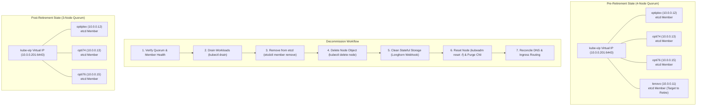

# Runbook: Kubernetes Control Plane Node Decommissioning & Retirement SOP

This Standard Operating Procedure (SOP) documents the architectural considerations, step-by-step procedures, and recovery edge cases for safely retiring or replacing a bare-metal Kubernetes stacked high-availability control-plane node (e.g., decommissioning `lenovo`) without loss of `etcd` quorum, service disruption, or orphaned cluster state.

---

## 🏗️ Architecture & Quorum Invariants

In a stacked Kubernetes control-plane topology using `kubeadm` and `kube-vip`, each control-plane node runs a static `etcd` pod participating in Raft distributed consensus alongside static `kube-apiserver`, `kube-controller-manager`, and `kube-scheduler` pods.



### 1. The Quorum Golden Rule
Raft consensus requires a strict majority of voting members:
$$Q = \left\lfloor \frac{N}{2} \right\rfloor + 1$$

- A **3-node** cluster requires 2 members to make progress and tolerates 1 failure.
- A **4-node** cluster requires 3 members to make progress and still only tolerates 1 failure.
- When replacing a node, **always join the new node first** (expanding from 3 to 4 nodes) before removing the retiring node. This ensures the cluster never drops to a fragile 2-node state where a single hiccup causes a complete quorum lock.

---

## 🛠️ Step-by-Step Decommissioning Workflow

### Step 1: Pre-Flight `etcd` Verification

Before evicting or removing any control-plane node, verify that all cluster members are active and synchronized.

From an active control-plane node with access to `/etc/kubernetes/pki/etcd/`:

```bash
# Verify cluster endpoint health and raft index synchronization
sudo ETCDCTL_API=3 etcdctl \
  --cacert=/etc/kubernetes/pki/etcd/ca.crt \
  --cert=/etc/kubernetes/pki/etcd/server.crt \
  --key=/etc/kubernetes/pki/etcd/server.key \
  --endpoints=https://10.0.0.12:2379,https://10.0.0.13:2379,https://10.0.0.15:2379 \
  endpoint status -w table
```

Confirm that `ERRORS` is blank, all members report the same `RAFT TERM`, and `RAFT APPLIED INDEX` is closely aligned across nodes.

---

### Step 2: Workload Eviction (Node Drain)

Safely evict scheduled workloads from the retiring node to healthy nodes in the cluster.

```bash
# Drain all workloads ignoring DaemonSets and local emptydir data
kubectl drain lenovo --ignore-daemonsets --delete-emptydir-data --force
```

> [!tip]
> **Longhorn Instance-Manager Consideration:**
> If using Longhorn distributed storage, Longhorn attaches a PodDisruptionBudget to protect `instance-manager` pods hosting active replicas. If the drain encounters a PDB violation on an instance manager, add `--pod-selector='longhorn.io/component!=instance-manager'` so user workloads are evicted while leaving storage daemons untouched until final cleanup.

---

### Step 3: Remove Node from `etcd` Raft Membership

> [!important]
> **Always Remove from etcd Before Deleting the Node:**
> If you delete the Kubernetes node object or run `kubeadm reset` without first removing the node from `etcd`, the remaining members will continue attempting to reach the absent peer indefinitely, generating log spam and lowering cluster fault tolerance.

1. List all active members to identify the hex member ID of the retiring node:
   ```bash
   sudo ETCDCTL_API=3 etcdctl \
     --cacert=/etc/kubernetes/pki/etcd/ca.crt \
     --cert=/etc/kubernetes/pki/etcd/server.crt \
     --key=/etc/kubernetes/pki/etcd/server.key \
     --endpoints=https://10.0.0.12:2379,https://10.0.0.13:2379,https://10.0.0.15:2379 \
     member list -w table
   ```

2. Remove the retiring member using its ID (e.g. `cebdf10928a06f3c`):
   ```bash
   sudo ETCDCTL_API=3 etcdctl \
     --cacert=/etc/kubernetes/pki/etcd/ca.crt \
     --cert=/etc/kubernetes/pki/etcd/server.crt \
     --key=/etc/kubernetes/pki/etcd/server.key \
     --endpoints=https://10.0.0.12:2379,https://10.0.0.13:2379,https://10.0.0.15:2379 \
     member remove <member-hex-id>
   ```

3. Verify that the member list now contains only the remaining active control-plane nodes.

---

### Step 4: Remove the Kubernetes Node Object

Delete the node registration from the Kubernetes API:

```bash
kubectl delete node lenovo
```

Verify that `kubectl get nodes` shows only the remaining active nodes in the cluster.

---

### Step 5: Stateful Storage Cleanup (Longhorn CSI)

If the retiring node previously participated in Longhorn distributed storage:

1. Attempting a direct `kubectl delete nodes.longhorn.io <node>` will be rejected by `validator.longhorn.io` if `spec.allowScheduling` is still `true`.
2. Disable scheduling on the Longhorn node object via a merge patch:
   ```bash
   kubectl patch nodes.longhorn.io lenovo -n longhorn-system \
     --type=merge -p '{"spec":{"allowScheduling":false}}'
   ```
3. Once marked unschedulable with 0 remaining replicas, Longhorn's controller will automatically garbage-collect the orphaned node object. Verify with `kubectl get nodes.longhorn.io -n longhorn-system`.

---

### Step 6: Reset Node and Clean CNI Interfaces

Log in directly to the retiring host (e.g., `lenovo`) to cleanly reset the `kubeadm` state and remove lingering CNI network devices.

```bash
# 1. Reset kubeadm configuration, iptables/IPVS rules, and static pod manifests
sudo kubeadm reset -f

# 2. Remove static pod manifests, etcd data, and CNI directories
sudo rm -rf /etc/cni/net.d /var/lib/etcd /etc/kubernetes/manifests

# 3. Clean up overlay and CNI virtual network interfaces
sudo ip link delete cilium_vxlan 2>/dev/null || true
sudo ip link delete cilium_host 2>/dev/null || true
sudo ip link delete genev_sys_6081 2>/dev/null || true

# 4. Clean up Open vSwitch datapath interfaces (if using Kube-OVN)
sudo ctr -n k8s.io run --rm --net-host --privileged \
  docker.io/kubeovn/kube-ovn:v1.16.17 ovs-clean ovs-dpctl del-dp ovs-system 2>/dev/null || true
sudo modprobe -r openvswitch 2>/dev/null || true
```

---

### Step 7: Reconcile Cloudflare DNS, Ingress, and GitOps Routing

When retiring a node that previously served ingress traffic or participated in wildcard DNS records, DNS and proxy records must be updated promptly.

#### 1. The RFC 6724 Local Interface Sorting Trap
If the retiring host's IP address remains in round-robin DNS records (such as `*.lambertlab.us`), Linux `glibc` (`getaddrinfo`) on that retired machine will **always sort its own local IP first** ahead of remote cluster IPs (**RFC 6724 Rule 2: Prefer matching scope / local interface**). 

Because the Kubernetes ingress controller (Traefik) is no longer running on the retired machine, any attempt from that host to access cluster subdomains (`argocd.lambertlab.us`, `vault.lambertlab.us`) will attempt to connect to `127.0.0.1` or the local interface and immediately fail (`connection refused` or timeout), even though remote nodes are healthy.

#### 2. Updating Cloudflare DNS Records with Terraform
Manage DNS declaratively by replacing the retired node's record with the new node in Terraform:

In `terraform/tailscale.tf`:
```hcl
data "tailscale_device" "opti76" {
  name = "opti76.${var.tailscale_tailnet}"
}
```

In `terraform/cloudflare.tf`:
```hcl
# Replace wildcard_lenovo with wildcard_opti76
resource "cloudflare_dns_record" "wildcard_opti76" {
  zone_id = data.cloudflare_zone.main.id
  name    = "*"
  content = data.tailscale_device.opti76.addresses[0]
  type    = "A"
  ttl     = 300
  proxied = false
  comment = "k8s opti76 - Managed by Terraform"
}
```

Execute a targeted Terraform plan and apply to swap the DNS records without touching unrelated infrastructure:

```bash
# 1. Preview the targeted DNS changes
terraform -chdir=terraform plan \
  -target=cloudflare_dns_record.wildcard_lenovo \
  -target=cloudflare_dns_record.wildcard_opti76

# 2. Apply the targeted record swap
terraform -chdir=terraform apply -auto-approve \
  -target=cloudflare_dns_record.wildcard_lenovo \
  -target=cloudflare_dns_record.wildcard_opti76

# 3. Verify public DNS propagation
dig +short @1.1.1.1 argocd.lambertlab.us
```

#### 3. Preserving Management Access in Ingress ACLs
If the retired machine transitions to a dedicated development or administrative host, update your Traefik Ingress Middleware (`access-control-list-middleware.yaml`) and ArgoCD Ingress to **retain** the retired host's IP while adding the new node:

```yaml
spec:
  ipAllowList:
    sourceRange:
      - 100.95.104.11/32   # lenovo (Admin & Orchestration Host)
      - 100.126.176.71/32  # opti76 (New Control Plane Node)
      - 100.74.145.55/32   # optiplex
      - 100.65.236.98/32   # opti74
      - 100.106.96.18/32   # workstation
```

#### 4. CoreDNS NodeHosts Reconciliation
Update custom `NodeHosts` mappings in `kubernetes/config/coredns/coredns.yaml` to include the new node (e.g., `10.0.0.15 opti76.lan opti76`) and restart the CoreDNS deployment:

```bash
kubectl rollout restart deployment/coredns -n kube-system
```
