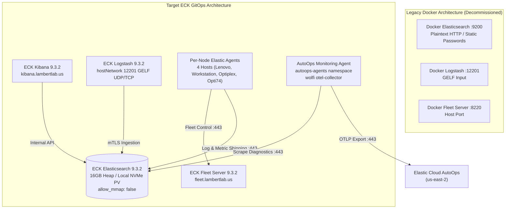

# Runbook: Docker to ECK Operator Migration & Elastic AutoOps Cloud Connect

This runbook documents the complete end-to-end migration of the **LambertLab** observability stack from standalone Docker containers on `workstation` to the **Elastic Cloud on Kubernetes (ECK) Operator (`v3.5.0`)** in the `observability` namespace, as well as the integration of **Elastic AutoOps Cloud Connect**.

---

## 🏛️ Architectural Overview & Transformation

Prior to migration, Elasticsearch 8.x, Logstash, and Fleet Server ran as standalone Docker containers on the `workstation` node. While functional, this introduced manual operational overhead, unmanaged TLS certificates, and lack of GitOps lifecycle management.



---

## 📋 Procedure 1: Backup & 50MB Config-Only Snapshot

To migrate all dashboards, saved searches, detection rules, alerts, and Fleet policies without copying 35+ GB of ephemeral container logs, a **config-only snapshot** was created.

### 1.1 Snapshot Parameter Specification

```json
PUT _snapshot/migration_repo/homelab_config_v1?wait_for_completion=true
{
  "indices": ".kibana*,.fleet*,.security*",
  "include_global_state": true,
  "feature_states": ["kibana", "fleet"]
}
```

* **`indices`**: Captures `.kibana*` (~36 MB, 58 dashboards, 42 saved searches, Lens visualizations), `.fleet*` (agent policies), and `.security*` (API keys, service tokens, roles). Completely excludes data streams (`homelab-logs-*`, `.ds-metrics-*`).
* **`include_global_state`**: Preserves cluster metadata, index templates, and Index Lifecycle Management (ILM) retention policies.
* **`feature_states`**: Ensures transactional consistency for system indices during snapshot and restore.

### 1.2 Preparation on Workstation
Create host directories with proper UID ownership:
```bash
ssh workstation "sudo mkdir -p /home/chris/services/elasticsearch/data /home/chris/services/elasticsearch/snapshots && sudo chown -R 1000:1000 /home/chris/services/elasticsearch/data /home/chris/services/elasticsearch/snapshots"
```

### 1.3 Register Repository & Execute Snapshot in Docker
1. Mount `/home/chris/services/elasticsearch/snapshots` to `/usr/share/elasticsearch/snapshots` in the Docker Elasticsearch container and configure `path.repo: /usr/share/elasticsearch/snapshots`.
2. Register the snapshot repository:
   ```bash
   curl -X PUT "http://100.106.96.18:9200/_snapshot/migration_repo" \
     -u elastic:<elastic_password> \
     -H "Content-Type: application/json" \
     -d '{
       "type": "fs",
       "settings": {
         "location": "/usr/share/elasticsearch/snapshots",
         "compress": true
       }
     }'
   ```
3. Trigger the snapshot:
   ```bash
   curl -X PUT "http://100.106.96.18:9200/_snapshot/migration_repo/homelab_config_v1?wait_for_completion=true" \
     -u elastic:<elastic_password> \
     -H "Content-Type: application/json" \
     -d '{
       "indices": ".kibana*,.fleet*,.security*",
       "include_global_state": true,
       "feature_states": ["kibana", "fleet"]
     }'
   ```
4. Verify snapshot state:
   ```bash
   curl -s -u elastic:<elastic_password> "http://100.106.96.18:9200/_snapshot/migration_repo/homelab_config_v1" | jq '.snapshots[0].state'
   # Expected output: "SUCCESS"
   ```

---

## 🚀 Procedure 2: Deploying ECK Elasticsearch to Kubernetes

### 2.1 PersistentVolume Configuration (`kubernetes/observability/elasticsearch/storage.yaml`)
A dedicated PersistentVolume locks the local NVMe storage to the exact pod instance:
```yaml
---
apiVersion: v1
kind: PersistentVolume
metadata:
  name: elasticsearch-data-pv
spec:
  capacity:
    storage: 100Gi
  accessModes:
    - ReadWriteOnce
  persistentVolumeReclaimPolicy: Retain
  storageClassName: manual
  hostPath:
    path: /home/chris/services/elasticsearch/data
  nodeAffinity:
    required:
      nodeSelectorTerms:
        - matchExpressions:
            - key: kubernetes.io/hostname
              operator: In
              values:
                - workstation
  claimRef:
    namespace: observability
    name: elasticsearch-data-elasticsearch-es-default-0
```

### 2.2 Preserving the Master Password via Vault (`external-secrets.yaml`)
An `ExternalSecret` retrieves the existing `elastic_password` from HashiCorp Vault (`secret/data/homelab`) and provisions `elasticsearch-es-elastic-user` so the operator preserves the established master password:
```yaml
---
apiVersion: external-secrets.io/v1
kind: ExternalSecret
metadata:
  name: elasticsearch-es-elastic-user
  namespace: observability
spec:
  refreshInterval: 1h
  secretStoreRef:
    kind: ClusterSecretStore
    name: vault-backend
  target:
    name: elasticsearch-es-elastic-user
    creationPolicy: Owner
    template:
      engineVersion: v2
      data:
        elastic: "{{ .elastic_password }}"
  data:
    - secretKey: elastic_password
      remoteRef:
        key: secret/data/homelab
        property: elastic_password
```

### 2.3 Elasticsearch Custom Resource (`elasticsearch.yaml`)
Key configurations include:
* **`node.store.allow_mmap: false`**: Bypasses the strict `vm.max_map_count >= 262144` check, allowing unprivileged execution without requiring a privileged host-level sysctl `initContainer`.
* **`path.repo: [/mnt/snapshots]`**: Mounts the host snapshot folder.
* **16GB Heap**: Configured via `ES_JAVA_OPTS="-Xms16g -Xmx16g"` backed by 20Gi container memory limit.

---

## 🔄 Procedure 3: Restoring the Snapshot into ECK

Once `elasticsearch-es-default-0` is in `Running` state:

1. Register the repository in ECK:
   ```bash
   ES_PASS=$(kubectl get secret elasticsearch-es-elastic-user -n observability -o jsonpath="{.data.elastic}" | base64 -d)
   kubectl run es-init --rm -it --restart=Never --image=curlimages/curl -n observability -- \
     curl -k -X PUT "https://elasticsearch-es-http:9200/_snapshot/migration_repo" \
     -u "elastic:$ES_PASS" \
     -H "Content-Type: application/json" \
     -d '{
       "type": "fs",
       "settings": {
         "location": "/mnt/snapshots"
       }
     }'
   ```

2. Restore the configuration snapshot:
   ```bash
   kubectl run es-restore --rm -it --restart=Never --image=curlimages/curl -n observability -- \
     curl -k -X POST "https://elasticsearch-es-http:9200/_snapshot/migration_repo/homelab_config_v1/_restore?wait_for_completion=true" \
     -u "elastic:$ES_PASS" \
     -H "Content-Type: application/json" \
     -d '{
       "indices": ".kibana*,.fleet*,.security*",
       "include_global_state": true
     }'
   ```

3. Strip replica requirements across restored indices to maintain **`GREEN`** cluster status on a single node:
   ```bash
   curl -k -X PUT -u "elastic:$ES_PASS" "https://es.lambertlab.us/*/_settings" \
     -H "Content-Type: application/json" \
     -d '{
       "index": {
         "number_of_replicas": 0
       }
     }'
   ```

---

## 📊 Procedure 4: Kibana & Logstash Cutover

### 4.1 Kibana Association (`kibana.yaml`)
Configured with native operator association:
```yaml
spec:
  version: 9.3.2
  count: 1
  elasticsearchRef:
    name: elasticsearch
  config:
    server.publicBaseUrl: "https://kibana.lambertlab.us"
    logging.root.level: "warn"
```
The operator automatically provisions service accounts and mutual TLS certificates between Kibana and Elasticsearch.

### 4.2 Logstash Ingestion via HostNetwork 12201 (`logstash.yaml`)
To ingest container logs from all Docker daemons over the Tailscale network without modifying Docker daemon logging configs, Logstash runs directly on the workstation host network with `hostNetwork: true`:
```yaml
podTemplate:
  spec:
    hostNetwork: true
    dnsPolicy: ClusterFirstWithHostNet
    nodeSelector:
      kubernetes.io/hostname: workstation
    containers:
      - name: logstash
        ports:
          - name: gelf-udp
            containerPort: 12201
            protocol: UDP
          - name: gelf-tcp
            containerPort: 12201
            protocol: TCP
```
By utilizing `hostNetwork: true`, Logstash binds to all physical and virtual interfaces (including `tailscale0` at `100.106.96.18:12201`), while `dnsPolicy: ClusterFirstWithHostNet` preserves in-cluster DNS resolution for CoreDNS and Kubernetes services (`elasticsearch-es-http.observability.svc`). Incoming logs are tagged with `received_at` and indexed directly into `logstash-%{+YYYY.MM.dd}` with `number_of_replicas: 0`.

---

## 🛡️ Procedure 5: Fleet Server & Agent Ingress Architecture

### 5.1 The Kube-OVN HostNetwork Caveat
Homelab host agents (`agent-pernode-elastic-agent`) run with `hostNetwork: true` to capture bare-metal network, system, and kernel metrics. Because Kube-OVN isolates the overlay network, host-networked pods cannot route across nodes to Kubernetes ClusterIPs (`10.96.0.0/12`). 

**Resolution:** Agents route to Fleet Server and Elasticsearch via Traefik Ingress:
* Fleet Endpoint: `https://fleet.lambertlab.us`
* Elasticsearch Endpoint: `https://es.lambertlab.us`

### 5.2 Traefik Backend Insecure Transport
Because ECK generates internal self-signed backend certificates, Traefik must communicate with the backend services using an insecure transport:
```yaml
---
apiVersion: traefik.io/v1alpha1
kind: ServersTransport
metadata:
  name: insecure-transport
  namespace: observability
spec:
  insecureSkipVerify: true
```
Secondary services (`fleet-server-agent-http-service` and `elasticsearch-es-http-service`) in `observability` reference this transport:
```yaml
annotations:
  traefik.ingress.kubernetes.io/service.serversscheme: https
  traefik.ingress.kubernetes.io/service.serverstransport: observability-insecure-transport@kubernetescrd
```

### 5.3 Purging Stale Fleet API Keys
Restoring `.kibana` from the standalone Docker snapshot restores legacy API keys named `Default` that Elasticsearch does not recognize. Purge the stale keys via the Kibana Fleet API so Fleet Server generates valid active enrollment tokens:
```bash
curl -sk -u "elastic:$ES_PASS" -X DELETE "https://kibana.lambertlab.us/api/fleet/enrollment_api_keys/<stale_key_id>" \
  -H "kbn-xsrf: true"
```

---

## 🧹 Procedure 6: Decommissioning Docker Resources

Once the ECK stack is validated:

1. Target-destroy Docker ELK containers and resources on `workstation`:
   ```bash
   terraform -chdir=terraform destroy \
     -target=module.docker_apps.docker_container.elasticsearch \
     -target=module.docker_apps.docker_container.logstash \
     -target=module.docker_apps.docker_container.fleet_server \
     -target=module.docker_apps.docker_image.elasticsearch \
     -target=module.docker_apps.docker_image.logstash \
     -target=module.docker_apps.docker_network.elk_bridge
   ```

2. Move Terraform manifests into `docker/archived/` using `git mv`:
   ```bash
   git mv docker/workstation/app-elasticsearch.tf docker/archived/
   git mv docker/workstation/app-logstash.tf docker/archived/
   git mv docker/workstation/app-fleet-server.tf docker/archived/
   ```

3. Remove decommissioned variables from `docker/workstation/variables.tf`, `terraform/main.tf`, and `terraform/vault.tf`.

---

## ☁️ Procedure 7: Elastic AutoOps Cloud Connect

Elastic AutoOps provides cloud-hosted diagnostic insights and proactive shard analysis for self-managed clusters.

### 7.1 Architecture & Kustomize Deployment
Instead of managing large static manifests or embedding plaintext secrets in Helm values, AutoOps is deployed via **remote Kustomize** in `kubernetes/observability/autoops/`:

```yaml
---
apiVersion: kustomize.config.k8s.io/v1beta1
kind: Kustomization
namespace: autoops-agents
resources:
  - https://raw.githubusercontent.com/elastic/autoops-install/main/k8s/autoops_agent_deployment.yaml
  - external-secrets.yaml
```

* **Image:** `docker.elastic.co/elastic-agent/elastic-otel-collector-wolfi:9.4.3` (OpenTelemetry Collector with built-in `otel_samples/autoops_es.yml`).
* **Vault Integration:** Sensitive cloud tokens (`autoops_token`, `elastic_cloud_connected_mode_api_key`, `temp-resource-id`, `es_password`) are stored in Vault under `secret/data/autoops` and mapped into `autoops-secret` via `ExternalSecret` with `creationPolicy: Owner`.
* **Telemetry Route:** Scrapes diagnostics locally from `https://es.lambertlab.us` and exports OTLP metrics over HTTPS to Elastic Cloud (`https://otel-auto-ops.us-east-2.aws.svc.elastic.cloud`).

### 7.2 Verification
Verify the agent has successfully registered:
```bash
kubectl logs -n autoops-agents deployment/autoops-elastic-agent --tail=20
```
Expected output confirms cluster registration:
```text
Registered cluster <cluster_id> for Cloud Connect: <resource_id>
autoops_es.cat_shards: success
autoops_es.cluster_health: success
events: acked by Elastic Cloud AutoOps
```
Access the resulting insights directly on **[cloud.elastic.co](https://cloud.elastic.co)** under **Deployments > AutoOps**.
