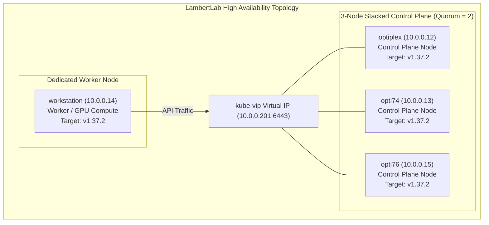

# Runbook: Kubernetes HA Control Plane & Node Rolling Upgrade SOP (`kubeadm`)

This Standard Operating Procedure (SOP) documents the operational workflow, package pinning invariants, step-by-step commands, and failure recovery protocols for executing minor and patch-level Kubernetes rolling upgrades across the **LambertLab** cluster using **`kubeadm`**.

---

## 🏗️ Architecture & Operational Invariants



### 1. Mandatory Package Pinning Policy
In Debian/Ubuntu environments, automated package update daemons (such as `unattended-upgrades`) can silently pull newer versions of Kubernetes binaries, causing uncoordinated component version skews and control-plane split-brains.
* **The Rule:** `kubeadm`, `kubelet`, and `kubectl` **MUST ALWAYS** remain marked as `hold` via `apt-mark` across **all** nodes in the cluster.
* **The Workflow:** During planned maintenance, packages are explicitly unheld, updated to the exact pinned version (`<version>-1.1`), and immediately placed back on `hold`.

### 2. Upgrade Command Invariant: Primary vs. Secondary Nodes
* **First Control Plane Node:**
  Uses **`sudo kubeadm upgrade apply v1.X.Y`**. This command updates the cluster configuration in the `kube-system/kubeadm-config` ConfigMap, renews control-plane leaf certificates, updates static pod manifests (`kube-apiserver`, `kube-controller-manager`, `kube-scheduler`, `etcd`), and handles addon RBAC.
* **Subsequent Control Planes:**
  Uses **`sudo kubeadm upgrade node`**. **NEVER run `upgrade apply` on secondary control planes.** `upgrade node` fetches the updated cluster configuration directly from the cluster ConfigMap and regenerates local static manifests.
* **Worker Nodes:**
  Uses **`sudo kubeadm upgrade node`**. Updates the local kubelet configuration. Draining is optional on worker nodes hosting long-running stateful services (such as VMs) because `containerd` continues running all active pods and workloads uninterrupted during a local `kubelet` restart.

---

## ⚠️ Pre-Flight Considerations & etcd Health Checks

> [!important]
> **Sequential Upgrades Only:** Always execute node upgrades one node at a time. The 3-node stacked etcd control plane requires $Q = \lfloor 3/2 \rfloor + 1 = 2$ active members to maintain write quorum. Never take two control planes offline simultaneously.

> [!tip]
> **etcd Pre-Upgrade Health & Defragmentation:**
> Before initiating control-plane node upgrades, verify etcd cluster health and ensure database fragmentation is minimal. Running a compaction and defragmentation before upgrading guarantees that peer snapshot synchronization is lean and instantaneous if a node temporarily disconnects during manifest regeneration.
> 
> ```bash
> # Verify endpoint health across all control planes
> sudo ETCDCTL_API=3 etcdctl \
>   --cacert=/etc/kubernetes/pki/etcd/ca.crt \
>   --cert=/etc/kubernetes/pki/etcd/server.crt \
>   --key=/etc/kubernetes/pki/etcd/server.key \
>   --endpoints=https://127.0.0.1:2379 endpoint health
> ```

---

## 🛠️ Step-by-Step Upgrade Workflow

### Stage 1: Upgrade the First Control Plane Node

Execute on the designated first control-plane node (e.g. `optiplex`):

#### 1. Unhold and Upgrade `kubeadm`
```bash
sudo apt-mark unhold kubeadm
sudo apt-get update && sudo apt-get install -y kubeadm=1.37.2-1.1
sudo apt-mark hold kubeadm

# Verify downloaded version
kubeadm version
```

#### 2. Verify Upgrade Plan
```bash
sudo kubeadm upgrade plan
```

#### 3. Apply the Upgrade
```bash
sudo kubeadm upgrade apply v1.37.2
```
> [!note]
> If using Cilium in pure eBPF mode (`kubeProxyReplacement=true`), `kubeadm` will output:
> `Warning: No kubeproxy.config.k8s.io/v1alpha1 config is loaded. Continuing without it: configmaps "kube-proxy" not found`
> This warning is completely normal and expected.

#### 4. Drain Workloads from the Node
```bash
kubectl drain <first-control-plane> --ignore-daemonsets --delete-emptydir-data --pod-selector='longhorn.io/component!=instance-manager'
```

#### 5. Upgrade `kubelet` and `kubectl`
```bash
sudo apt-mark unhold kubelet kubectl
sudo apt-get install -y kubelet=1.37.2-1.1 kubectl=1.37.2-1.1
sudo apt-mark hold kubelet kubectl

sudo systemctl daemon-reload
sudo systemctl restart kubelet
```

#### 6. Uncordon the First Control Plane Node
```bash
kubectl uncordon <first-control-plane>
kubectl get nodes -o wide
```

---

### Stage 2: Upgrade Subsequent Control Planes (`opti74`, then `opti76`)

Execute sequentially on each remaining control plane node, one at a time:

#### 1. Unhold and Upgrade `kubeadm`
```bash
sudo apt-mark unhold kubeadm
sudo apt-get update && sudo apt-get install -y kubeadm=1.37.2-1.1
sudo apt-mark hold kubeadm
```

#### 2. Upgrade Node Components
```bash
# DO NOT run 'kubeadm upgrade apply'!
sudo kubeadm upgrade node
```

#### 3. Drain Workloads
```bash
kubectl drain <node-name> --ignore-daemonsets --delete-emptydir-data --pod-selector='longhorn.io/component!=instance-manager'
```

#### 4. Upgrade `kubelet` and `kubectl`
```bash
sudo apt-mark unhold kubelet kubectl
sudo apt-get install -y kubelet=1.37.2-1.1 kubectl=1.37.2-1.1
sudo apt-mark hold kubelet kubectl

sudo systemctl daemon-reload
sudo systemctl restart kubelet
```

#### 5. Uncordon the Node
```bash
kubectl uncordon <node-name>
kubectl get nodes -o wide
```

---

### Stage 3: Upgrade Worker Nodes (`workstation`)

Because `containerd` continues running all active pods and virtual machines uninterrupted during a local `kubelet` restart, worker nodes hosting long-running stateful services (such as KubeVirt VMs or single-node databases) can be upgraded with zero downtime without a full eviction drain.

#### Method A: Zero-Downtime Cordon Upgrade (Recommended for Nodes with VMs)
```bash
# 1. Cordon the worker node to prevent new pod scheduling
kubectl cordon <worker-node>

# 2. Upgrade kubeadm and local kubelet configuration
ssh <worker-node> "sudo apt-mark unhold kubeadm && sudo apt-get update && sudo apt-get install -y kubeadm=1.37.2-1.1 && sudo apt-mark hold kubeadm"
ssh <worker-node> "sudo kubeadm upgrade node"

# 3. Upgrade kubelet and kubectl packages
ssh <worker-node> "sudo apt-mark unhold kubelet kubectl && sudo apt-get install -y kubelet=1.37.2-1.1 kubectl=1.37.2-1.1 && sudo apt-mark hold kubelet kubectl"

# 4. Restart kubelet service (containerd keeps all containers and VMs running)
ssh <worker-node> "sudo systemctl daemon-reload && sudo systemctl restart kubelet"

# 5. Uncordon the worker node
kubectl uncordon <worker-node>
```

#### Method B: Eviction Drain (Standard Stateless Worker Upgrade)
If you prefer to evict all workloads before upgrading:
```bash
kubectl drain <worker-node> --ignore-daemonsets --delete-emptydir-data --pod-selector='longhorn.io/component!=instance-manager'
# Then follow package upgrade steps 2-5 above.
```

---

## 🔍 Post-Upgrade Verification

Verify that all control-plane and worker nodes report `Ready`, and ensure all workloads across system and user namespaces are running cleanly:

```bash
# Verify all nodes are updated to target version and Ready
kubectl get nodes -o wide

# Verify all cluster pods are Running or Completed
kubectl get pods -A --field-selector=status.phase!=Running,status.phase!=Succeeded
```
