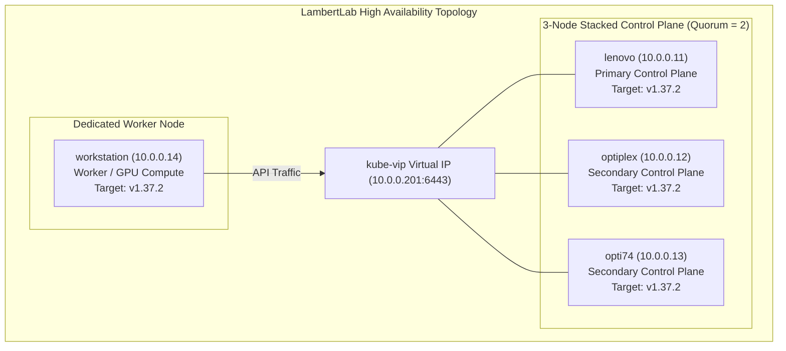

# Runbook: Kubernetes HA Control Plane & Node Rolling Upgrade SOP (`kubeadm`)

This Standard Operating Procedure (SOP) documents the operational workflow, package pinning invariants, step-by-step commands, and failure recovery protocols for executing minor and patch-level Kubernetes rolling upgrades across the **LambertLab** cluster using **`kubeadm`**.

---

## 🏗️ Architecture & Operational Invariants



### 1. Mandatory Package Pinning Policy
In Debian/Ubuntu environments, automated package update daemons (such as `unattended-upgrades`) can silently pull newer versions of Kubernetes binaries, causing uncoordinated component version skews and control-plane split-brains.
* **The Rule:** `kubeadm`, `kubelet`, and `kubectl` **MUST ALWAYS** remain marked as `hold` via `apt-mark` across **all** nodes in the cluster.
* **The Workflow:** During planned maintenance, packages are explicitly unheld, updated to the exact pinned version (`<version>-1.1`), and immediately placed back on `hold`.

### 2. Upgrade Command Invariant: Primary vs. Secondary Nodes
* **Primary Control Plane (`lenovo`):**
  Uses **`sudo kubeadm upgrade apply v1.X.Y`**. This command updates the cluster configuration in the `kube-system/kubeadm-config` ConfigMap, renews control-plane leaf certificates, updates static pod manifests (`kube-apiserver`, `kube-controller-manager`, `kube-scheduler`, `etcd`), and handles addon RBAC.
* **Secondary Control Planes (`optiplex`, `opti74`):**
  Uses **`sudo kubeadm upgrade node`**. **NEVER run `upgrade apply` on secondary control planes.** `upgrade node` fetches the updated cluster configuration directly from the cluster ConfigMap and regenerates local static manifests.
* **Worker Nodes (`workstation`):**
  Uses **`sudo kubeadm upgrade node`**. Updates the local kubelet configuration.

---

## ⚠️ Pre-Flight Considerations & etcd Health Checks

> [!important]
> **Sequential Upgrades Only:** Always execute node upgrades one node at a time. The 3-node stacked etcd control plane requires $Q = \lfloor 3/2 \rfloor + 1 = 2$ active members to maintain write quorum. Never take two control planes offline simultaneously.

> [!tip]
> **etcd Pre-Upgrade Health & Defragmentation:**
> Before initiating control-plane node upgrades, verify etcd cluster health and ensure database fragmentation is minimal. Running a compaction and defragmentation before upgrading guarantees that peer snapshot synchronization is lean and instantaneous if a node temporarily disconnects during manifest regeneration.
> 
> ```bash
> # Verify endpoint health across all control planes
> sudo ETCDCTL_API=3 etcdctl \
>   --cacert=/etc/kubernetes/pki/etcd/ca.crt \
>   --cert=/etc/kubernetes/pki/etcd/server.crt \
>   --key=/etc/kubernetes/pki/etcd/server.key \
>   --endpoints=https://127.0.0.1:2379 endpoint health
> ```

---

## 🛠️ Step-by-Step Upgrade Workflow

### Stage 1: Upgrade the Primary Control Plane (`lenovo`)

Execute all commands locally on `lenovo`:

#### 1. Unhold and Upgrade `kubeadm`
```bash
sudo apt-mark unhold kubeadm
sudo apt-get update && sudo apt-get install -y kubeadm=1.37.2-1.1
sudo apt-mark hold kubeadm

# Verify downloaded version
kubeadm version
```

#### 2. Verify Upgrade Plan
```bash
sudo kubeadm upgrade plan
```

#### 3. Apply the Upgrade
```bash
sudo kubeadm upgrade apply v1.37.2
```
> [!note]
> If using Cilium in pure eBPF mode (`kubeProxyReplacement=true`), `kubeadm` will output:
> `Warning: No kubeproxy.config.k8s.io/v1alpha1 config is loaded. Continuing without it: configmaps "kube-proxy" not found`
> This warning is completely normal and expected.

#### 4. Drain Workloads from `lenovo`
```bash
kubectl drain lenovo --ignore-daemonsets --delete-emptydir-data
```

#### 5. Upgrade `kubelet` and `kubectl`
```bash
sudo apt-mark unhold kubelet kubectl
sudo apt-get install -y kubelet=1.37.2-1.1 kubectl=1.37.2-1.1
sudo apt-mark hold kubelet kubectl

sudo systemctl daemon-reload
sudo systemctl restart kubelet
```

#### 6. Uncordon `lenovo`
```bash
kubectl uncordon lenovo
kubectl get nodes -o wide
```

---

### Stage 2: Upgrade Secondary Control Planes (`optiplex` then `opti74`)

Execute sequentially on **`optiplex`**, and once verified healthy, repeat on **`opti74`**:

#### 1. Unhold and Upgrade `kubeadm`
```bash
sudo apt-mark unhold kubeadm
sudo apt-get update && sudo apt-get install -y kubeadm=1.37.2-1.1
sudo apt-mark hold kubeadm
```

#### 2. Upgrade Node Components
```bash
# DO NOT run 'kubeadm upgrade apply'!
sudo kubeadm upgrade node
```

#### 3. Drain Workloads
```bash
kubectl drain <node-name> --ignore-daemonsets --delete-emptydir-data
```

#### 4. Upgrade `kubelet` and `kubectl`
```bash
sudo apt-mark unhold kubelet kubectl
sudo apt-get install -y kubelet=1.37.2-1.1 kubectl=1.37.2-1.1
sudo apt-mark hold kubelet kubectl

sudo systemctl daemon-reload
sudo systemctl restart kubelet
```

#### 5. Uncordon the Node
```bash
kubectl uncordon <node-name>
kubectl get nodes -o wide
```

---

### Stage 3: Upgrade Worker Nodes (`workstation`)

Execute on `workstation`:

#### 1. Drain the Worker Node
```bash
kubectl drain workstation --ignore-daemonsets --delete-emptydir-data
```

#### 2. Upgrade `kubeadm` and Node Configuration
```bash
sudo apt-mark unhold kubeadm
sudo apt-get update && sudo apt-get install -y kubeadm=1.37.2-1.1
sudo apt-mark hold kubeadm

sudo kubeadm upgrade node
```

#### 3. Upgrade `kubelet` and `kubectl`
```bash
sudo apt-mark unhold kubelet kubectl
sudo apt-get install -y kubelet=1.37.2-1.1 kubectl=1.37.2-1.1
sudo apt-mark hold kubelet kubectl

sudo systemctl daemon-reload
sudo systemctl restart kubelet
```

#### 4. Uncordon the Worker Node
```bash
kubectl uncordon workstation
kubectl get nodes -o wide
```

---

## 🔍 Day-2 Verification & Incident Recovery

### 1. Post-Upgrade Health Checks
Verify that all control-plane and worker nodes report `Ready`, and ensure all workloads across system and user namespaces are running cleanly:
```bash
kubectl get nodes -o wide
kubectl get pods -A --field-selector=status.phase!=Running,status.phase!=Succeeded
```

### 2. Resolving Stalled etcd Peer Snapshot Synchronization
If a node was offline long enough to exceed `--snapshot-count=10000` transactions and the database on the leader has accumulated fragmented bbolt freelist space:
1. **Temporarily halt local static container to stop sync loops:**
   ```bash
   sudo mv /etc/kubernetes/manifests/etcd.yaml /etc/kubernetes/etcd.yaml.bak
   sudo pkill -9 etcd
   ```
2. **Compact historical revisions on an active healthy peer:**
   ```bash
   CURRENT_REV=$(sudo curl -s -k -X POST -d '{}' \
     --cacert /etc/kubernetes/pki/etcd/ca.crt \
     --cert /etc/kubernetes/pki/etcd/server.crt \
     --key /etc/kubernetes/pki/etcd/server.key \
     https://127.0.0.1:2379/v3/maintenance/status | jq -r .header.revision)

   sudo curl -s -k -X POST -d "{\"revision\": \"$CURRENT_REV\"}" \
     --cacert /etc/kubernetes/pki/etcd/ca.crt \
     --cert /etc/kubernetes/pki/etcd/server.crt \
     --key /etc/kubernetes/pki/etcd/server.key \
     https://127.0.0.1:2379/v3/kv/compaction
   ```
3. **Defragment remaining members:**
   ```bash
   sudo curl -s -k -X POST -d '{}' \
     --cacert /etc/kubernetes/pki/etcd/ca.crt \
     --cert /etc/kubernetes/pki/etcd/server.crt \
     --key /etc/kubernetes/pki/etcd/server.key \
     https://127.0.0.1:2379/v3/maintenance/defragment
   ```
4. **Purge partial temp snapshots on the reconnecting node and restore manifest:**
   ```bash
   sudo rm -f /var/lib/etcd/member/snap/tmp*
   sudo mv /etc/kubernetes/etcd.yaml.bak /etc/kubernetes/manifests/etcd.yaml
   ```
   The compact database snapshot transfers in seconds, bringing the node back into quorum.
