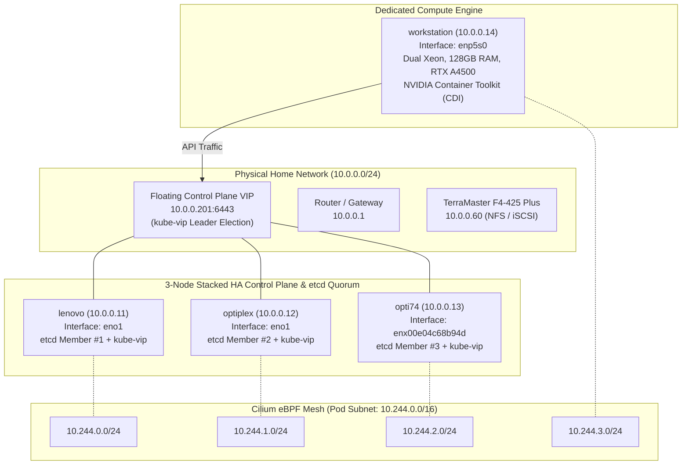

# Runbook: K3s to Vanilla Kubeadm HA & Cilium eBPF Migration SOP

This Standard Operating Procedure (SOP) documents the architectural design, teardown, bootstrap, and verification procedures for migrating the **LambertLab** cluster from K3s to an enterprise-grade vanilla upstream **`kubeadm` (v1.37.1)** architecture with stacked etcd High Availability, **`kube-vip`** control plane failover, **Cilium** in pure eBPF mode (replacing `kube-proxy`), and dedicated NVIDIA GPU worker orchestration.

---

## 🏗️ Target Architecture Overview



### Physical Node & Role Matrix

| Node Hostname | Hardware Specifications | Target Roles | Network Interface | LAN IP | Pod CIDR (Cilium IPAM) |
| :--- | :--- | :--- | :--- | :--- | :--- |
| **`lenovo`** | Intel Core i7-6700T, 32GB RAM | `control-plane`, `etcd` (Bootstrap S1) | `eno1` | `10.0.0.11` | `10.244.0.0/24` |
| **`optiplex`** | Intel Core i7-4770, 16GB RAM | `control-plane`, `etcd` | `eno1` | `10.0.0.12` | `10.244.1.0/24` |
| **`opti74`** | Intel Core i7-6700, 32GB RAM | `control-plane`, `etcd` | `enx00e04c68b94d` (USB) | `10.0.0.13` | `10.244.2.0/24` |
| **`workstation`** | 2x Xeon E5-2667 v4, 128GB RAM, RTX A4500 | `worker` (Compute, GPU) | `enp5s0` | `10.0.0.14` | `10.244.3.0/24` |
| **Floating VIP** | Virtual IP (`kube-vip` Static Pod) | `controlPlaneEndpoint` | Layer 2 ARP Broadcast | **`10.0.0.201`** | N/A |

---

## 🔒 Phase 1: Pre-Migration Safety & Backups

Before decommissioning the legacy K3s cluster, full application state and storage volumes were captured and verified:

1. **Longhorn Persistent Volume Snapshots:**
   Targeted NFS storage appliance at `nfs://10.0.0.60:/Volume4/longhorn`:
   * `data-vault-0`: Snapshot verified on NAS.
   * `data-guacamole-postgresql-0`: Snapshot verified on NAS.
   * `cache-ntfy-0`: Snapshot verified on NAS.
2. **HashiCorp Vault Raft Database Backup:**
   Direct Raft engine snapshot saved to local administrative storage:
   ```bash
   vault operator raft snapshot save /home/chris/cluster-backup-20261015/vault-backup.snap
   ```

---

## 🧹 Phase 2: Host Operating System Preparation (All Nodes)

### 1. Decommission Legacy K3s
Cleanly uninstall the K3s supervisor and purge stale CNI devices to prevent iptables/routing collisions:

```bash
# On worker nodes:
sudo /usr/local/bin/k3s-agent-uninstall.sh 2>/dev/null || sudo /usr/local/bin/k3s-uninstall.sh

# On control plane nodes:
sudo /usr/local/bin/k3s-uninstall.sh

# Purge leftover state and network interfaces:
sudo rm -rf /etc/rancher /var/lib/rancher /var/lib/kubelet /etc/cni /opt/cni /var/lib/cni
sudo ip link delete cni0 2>/dev/null
sudo ip link delete flannel.1 2>/dev/null
```

### 2. Kernel Modules & Sysctl Network Forwarding
Kubernetes and containerd require Linux bridge netfilter and IP packet forwarding:

```bash
cat <<EOF | sudo tee /etc/modules-load.d/k8s.conf
overlay
br_netfilter
EOF

sudo modprobe overlay
sudo modprobe br_netfilter

cat <<EOF | sudo tee /etc/sysctl.d/k8s.conf
net.bridge.bridge-nf-call-iptables  = 1
net.bridge.bridge-nf-call-ip6tables = 1
net.ipv4.ip_forward                 = 1
EOF

sudo sysctl --system
```

### 3. Upstream `containerd` Installation & Systemd Cgroups
Generate the default containerd configuration and enforce `SystemdCgroup = true` to match Kubernetes v1.37 cgroup requirements:

```bash
sudo mkdir -p /etc/containerd
containerd config default | sudo tee /etc/containerd/config.toml
sudo sed -i 's/SystemdCgroup = false/SystemdCgroup = true/g' /etc/containerd/config.toml

sudo systemctl restart containerd
sudo systemctl enable containerd
```

*Verification:*
```bash
grep SystemdCgroup /etc/containerd/config.toml
```

### 4. Install Kubernetes Binaries (v1.37.1)
Pin the official community repository packages:

```bash
curl -fsSL https://pkgs.k8s.io/core:/stable:/v1.37/deb/Release.key | sudo gpg --dearmor -o /etc/apt/keyrings/kubernetes-apt-keyring.gpg
echo 'deb [signed-by=/etc/apt/keyrings/kubernetes-apt-keyring.gpg] https://pkgs.k8s.io/core:/stable:/v1.37/deb/ /' | sudo tee /etc/apt/sources.list.d/kubernetes.list

sudo apt update && sudo apt install -y kubelet kubeadm kubectl
sudo apt-mark hold kubelet kubeadm kubectl
```

### 5. Explicit Kubelet Node IP Pinning
Homelab nodes frequently have multiple network interfaces (Tailscale `tailscale0`, Docker bridges, KVM `virbr0`, or secondary USB adapters). To prevent Kubelet from binding to the wrong interface, pin each node's physical LAN IP in `/etc/default/kubelet`:

* **`lenovo`:**
  ```bash
  echo 'KUBELET_EXTRA_ARGS="--node-ip=10.0.0.11"' | sudo tee /etc/default/kubelet
  sudo systemctl daemon-reload && sudo systemctl restart kubelet
  ```
* **`optiplex`:**
  ```bash
  echo 'KUBELET_EXTRA_ARGS="--node-ip=10.0.0.12"' | sudo tee /etc/default/kubelet
  sudo systemctl daemon-reload
  ```
* **`opti74`:**
  ```bash
  echo 'KUBELET_EXTRA_ARGS="--node-ip=10.0.0.13"' | sudo tee /etc/default/kubelet
  sudo systemctl daemon-reload
  ```
* **`workstation`:**
  ```bash
  echo 'KUBELET_EXTRA_ARGS="--node-ip=10.0.0.14"' | sudo tee /etc/default/kubelet
  sudo systemctl daemon-reload
  ```

### 6. NVIDIA GPU Runtime (Workstation Only)
On `workstation`, configure NVIDIA Container Toolkit CDI integration:

```bash
sudo nvidia-ctk runtime configure --runtime=containerd
sudo systemctl restart containerd
```
*(Produces `/etc/containerd/conf.d/99-nvidia.toml` imported by containerd)*.

---

## ⚡ Phase 3: Primary Control Plane Bootstrap (`lenovo`)

### 1. Stage `kube-vip` Static Pod Manifest
Deploy the floating control plane VIP (`10.0.0.201`) on interface `eno1`:

```bash
sudo mkdir -p /etc/kubernetes/manifests
export VIP="10.0.0.201"
export INTERFACE="eno1"
export KVVERSION="v1.2.4"

alias kube-vip="sudo ctr image pull ghcr.io/kube-vip/kube-vip:$KVVERSION; sudo ctr run --rm --net-host ghcr.io/kube-vip/kube-vip:$KVVERSION vip /kube-vip"

kube-vip manifest pod \
  --interface $INTERFACE \
  --address $VIP \
  --controlplane \
  --services \
  --arp \
  --leaderElection | sudo tee /etc/kubernetes/manifests/kube-vip.yaml
```

> [!IMPORTANT]
> **Kubeconfig Volume Mount Note:**
> In Kubernetes v1.29+ / v1.37, during the raw `kubeadm init` bootstrap phase prior to RBAC application, the volume mount in `/etc/kubernetes/manifests/kube-vip.yaml` points to `/etc/kubernetes/super-admin.conf` on the host, while retaining `mountPath: /etc/kubernetes/admin.conf` inside the container.

### 2. Initialize Cluster with `kubeadm-config.yaml`
The cluster configuration disables `kube-proxy` and defines the pod subnet:

```yaml
---
apiVersion: kubeadm.k8s.io/v1beta4
kind: InitConfiguration
localAPIEndpoint:
  advertiseAddress: 10.0.0.11
  bindPort: 6443
nodeRegistration:
  criSocket: unix:///run/containerd/containerd.sock
  imagePullPolicy: IfNotPresent
  name: lenovo
  taints: []
---
apiVersion: kubeadm.k8s.io/v1beta4
kind: ClusterConfiguration
kubernetesVersion: 1.37.1
clusterName: homelab-cluster
controlPlaneEndpoint: "10.0.0.201:6443"
networking:
  podSubnet: 10.244.0.0/16
  serviceSubnet: 10.96.0.0/12
  dnsDomain: cluster.local
proxy:
  disabled: true # Replaced completely by Cilium eBPF
etcd:
  local:
    dataDir: /var/lib/etcd
```

Run initialization on `lenovo`:
```bash
sudo kubeadm init --config /home/chris/homelab/kubeadm-config.yaml --upload-certs
```

Set up user credentials:
```bash
mkdir -p $HOME/.kube
sudo cp -i /etc/kubernetes/admin.conf $HOME/.kube/config
sudo chown $(id -u):$(id -g) $HOME/.kube/config
```

---

## 🌐 Phase 4: Cilium CNI in Pure eBPF Mode

Deploy Cilium via Helm using the official **"Kubernetes Without kube-proxy"** quick-start pattern:

```bash
helm repo add cilium https://helm.cilium.io/
helm repo update

helm install cilium cilium/cilium --version 1.20.3 \
  --namespace kube-system \
  --set kubeProxyReplacement=true \
  --set k8sServiceHost="10.0.0.201" \
  --set k8sServicePort="6443" \
  --set ipam.mode=kubernetes \
  --set hubble.relay.enabled=true \
  --set hubble.ui.enabled=true
```

### Architectural Decisions & Parameter Breakdown:
* **`kubeProxyReplacement=true`:** Directs Cilium eBPF programs to attach to socket layer and cgroups to manage `ClusterIP`, `NodePort`, and `LoadBalancer` routing without iptables.
* **`k8sServiceHost="10.0.0.201"` & `k8sServicePort="6443"`:** Points Cilium agents directly to the `kube-vip` endpoint so agents can reach the API server prior to in-cluster service discovery availability.
* **`ipam.mode=kubernetes` (Critical):** Cilium's default `cluster-pool` IPAM assigns `10.0.0.0/8`, which conflicts with the physical `10.0.0.0/24` home LAN. Setting `ipam.mode=kubernetes` instructs Cilium to inherit the `podSubnet: 10.244.0.0/16` delegated by Kubernetes (`10.244.0.0/24` for lenovo, `10.244.1.0/24` for optiplex, etc.).
* **`hubble.relay.enabled=true` & `hubble.ui.enabled=true`:** Deploys flow aggregation and web visualization.

---

## 🤝 Phase 5: Joining Secondary Control Planes (`optiplex` & `opti74`)

### 1. Stage `kube-vip.yaml` on Secondary Nodes
Generate the manifest using the node's specific physical network interface. Note that secondary nodes use `admin.conf` directly:

* **On `optiplex` (interface `eno1`):**
  ```bash
  export VIP="10.0.0.201"
  export INTERFACE="eno1"
  export KVVERSION="v1.2.4"
  alias kube-vip="sudo ctr image pull ghcr.io/kube-vip/kube-vip:$KVVERSION; sudo ctr run --rm --net-host ghcr.io/kube-vip/kube-vip:$KVVERSION vip /kube-vip"
  sudo mkdir -p /etc/kubernetes/manifests
  kube-vip manifest pod --interface $INTERFACE --address $VIP --controlplane --services --arp --leaderElection | sudo tee /etc/kubernetes/manifests/kube-vip.yaml
  ```

* **On `opti74` (interface `enx00e04c68b94d`):**
  ```bash
  export VIP="10.0.0.201"
  export INTERFACE="enx00e04c68b94d"
  export KVVERSION="v1.2.4"
  alias kube-vip="sudo ctr image pull ghcr.io/kube-vip/kube-vip:$KVVERSION; sudo ctr run --rm --net-host ghcr.io/kube-vip/kube-vip:$KVVERSION vip /kube-vip"
  sudo mkdir -p /etc/kubernetes/manifests
  kube-vip manifest pod --interface $INTERFACE --address $VIP --controlplane --services --arp --leaderElection | sudo tee /etc/kubernetes/manifests/kube-vip.yaml
  ```

### 2. Generate Control Plane Join Command
On `lenovo`:
```bash
sudo kubeadm init phase upload-certs --upload-certs
# Output gives: <certificate-key>

kubeadm token create --print-join-command --certificate-key <certificate-key>
```

### 3. Execute Join
Run the generated join command with `sudo` on both `optiplex` and `opti74`:
```bash
sudo kubeadm join 10.0.0.201:6443 \
  --token <token> \
  --discovery-token-ca-cert-hash sha256:<hash> \
  --control-plane \
  --certificate-key <certificate-key>
```

> [!NOTE]
> During join, etcd initially attaches the node as a non-voting "learner" while synchronizing Raft state. Transient warnings (`etcdserver: can only promote a learner member which is in sync with leader`) are expected for several seconds until the initial Raft log replication catches up.

---

## 🛠️ Phase 6: Joining Dedicated Worker Node (`workstation`)

Because `workstation` is a pure compute worker:
* **No `kube-vip` static pod is placed on `workstation`.**
* Worker join does not use `--control-plane` or `--certificate-key`.

Run on `workstation`:
```bash
sudo kubeadm join 10.0.0.201:6443 \
  --token <token> \
  --discovery-token-ca-cert-hash sha256:<hash>
```

Label the node role:
```bash
kubectl label node workstation node-role.kubernetes.io/worker=worker
```

---

## ✅ Phase 7: Verification & Cluster Health Checks

### 1. Node Fleet Status
```bash
kubectl get nodes -o wide
```
*Expected Output:* All 4 nodes report `STATUS: Ready` with versions matching `v1.37.1` and their correct respective internal LAN IPs (`10.0.0.11`, `10.0.0.12`, `10.0.0.13`, `10.0.0.14`).

### 2. Cilium Pod IPAM Mesh
```bash
kubectl get ciliumnodes
```
*Expected Output:*
```text
NAME          CILIUMINTERNALIP   INTERNALIP   AGE
lenovo        10.244.0.49        10.0.0.11    ...
optiplex      10.244.1.149       10.0.0.12    ...
opti74        10.244.2.171       10.0.0.13    ...
workstation   10.244.3.86        10.0.0.14    ...
```

### 3. HA Leases & Control Plane Failover
```bash
kubectl get leases -n kube-system
```
*Expected Output:*
* `plndr-cp-lock`: Held by the active `kube-vip` leader node.
* `kube-controller-manager` & `kube-scheduler`: Active leader leases held.
* Individual `apiserver-<id>` heartbeat leases active for each control-plane member.

### 4. Hubble Observability Dashboard
Access the network dependency graph locally:
```bash
kubectl port-forward -n kube-system svc/hubble-ui 12000:80
```
Navigate to `http://localhost:12000` to inspect live cluster service communication.

---

## 🚀 Phase 8: Next Steps (GitOps Reconciliation)

With the foundation active, proceed to workload restoration:
1. **Apply Cilium LoadBalancer IP Pool:**
   Configure L2 announcements and reserve LAN IP blocks (e.g. `10.0.0.200/29`) for Traefik ingress.
2. **Restore Storage Engine (Longhorn CSI):**
   Install Longhorn, bind `nfs://10.0.0.60:/Volume4/longhorn`, and restore persistent volume claims for Vault and Postgres.
3. **Re-bootstrap Argo CD:**
   Deploy Argo CD in manual sync mode to phase the GitOps rollout across sync waves.
