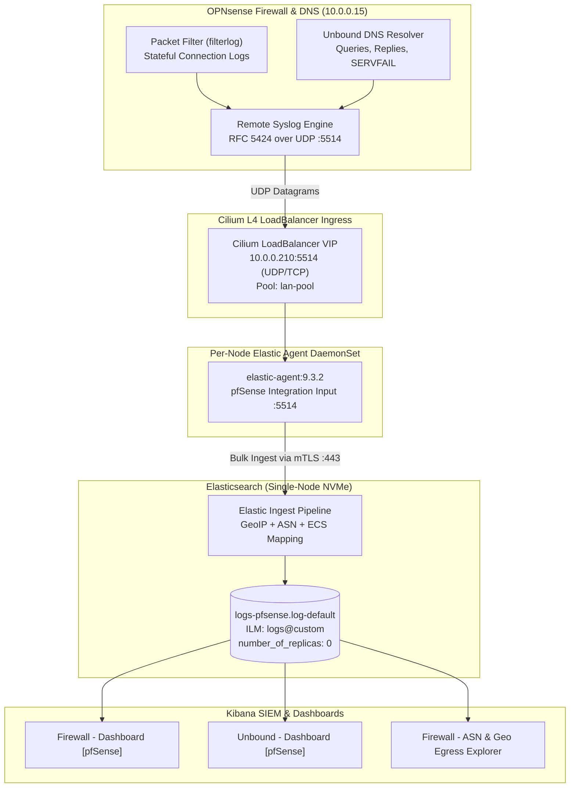
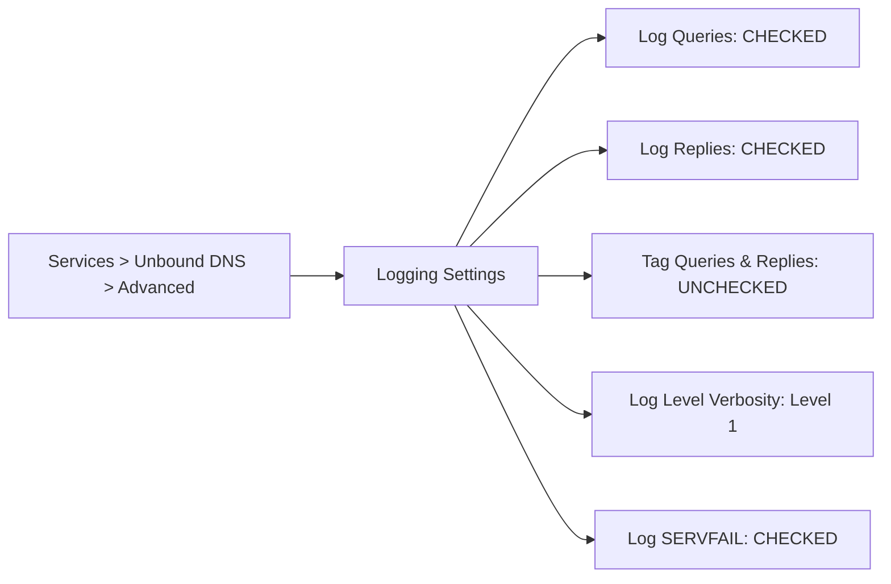

# Runbook: OPNsense Firewall & Unbound DNS Syslog Ingestion to Elastic SIEM

This runbook documents the complete end-to-end integration and configuration of **OPNsense** edge firewall and recursive **Unbound DNS** log telemetry into the **LambertLab** centralized Elastic Stack (SIEM) using the native Elastic Fleet `pfSense` integration and Cilium L4 LoadBalancer VIPs.

---

## 🏛️ Architectural Overview & Telemetry Flow

The integration leverages a high-throughput, zero-custom-Grok pipeline. OPNsense streams RFC 5424 structured syslog over UDP to a Kubernetes `LoadBalancer` VIP managed by Cilium. The stream routes to the host-networked `elastic-agent` DaemonSet, which forwards packets through Elasticsearch ingest pipelines for automated ECS parsing, ASN enrichment, and MaxMind GeoIP resolution.



---

## 📋 Procedure 1: Kubernetes Ingress Service Configuration

To expose the Elastic Agent syslog listener to external LAN appliances, deploy a dedicated Kubernetes `LoadBalancer` service managed by Cilium.

### 1.1 GitOps Service Manifest
Location: `kubernetes/observability/elastic-agent/service.yaml`

```yaml
---
apiVersion: v1
kind: Service
metadata:
  name: elastic-agent-syslog
  namespace: observability
  labels:
    app.kubernetes.io/name: elastic-agent
    app.kubernetes.io/instance: elastic-agent
    app.kubernetes.io/part-of: elastic-stack
  annotations:
    io.cilium/lb-ipam-ips: 10.0.0.210
spec:
  type: LoadBalancer
  selector:
    name: agent-pernode-elastic-agent
  ports:
    - name: syslog-udp
      port: 5514
      targetPort: 5514
      protocol: UDP
    - name: syslog-tcp
      port: 5514
      targetPort: 5514
      protocol: TCP
```

Verify service allocation:
- **Assigned VIP:** `10.0.0.210`
- **Cilium IPAM Pool:** `lan-pool` (`10.0.0.200 - 10.0.0.220`)
- **ARP Test:** `arping -I br0 10.0.0.210` answers on physical interface.

---

## 📋 Procedure 2: Fleet Agent Policy Configuration

1. In Kibana, navigate to **Management > Fleet > Agent policies**.
2. Select the active worker agent policy (e.g., `Elastic Agent on ECK Policy`).
3. Click **Add integration** and search for **pfSense** (Netgate / BSD packet filter).
4. Configure integration settings:
   - **Integration Name:** `pfsense-syslog`
   - **Listen Port:** `5514`
   - **Listen Protocol:** `UDP`
   - **Dataset:** `pfsense.log`
5. Save the integration. Fleet automatically rolls out the updated configuration to all per-node agent pods.

---

## 📋 Procedure 3: OPNsense Remote Logging Target Setup

To direct firewall and DNS syslog streams to Elastic Agent:

1. Log into the OPNsense Web UI (`https://opnsense.ad.lambertlab.us`).
2. Navigate to **System > Settings > Logging / Targets**.
3. Click the ➕ **Add** (or ✏️ **Edit**) button to configure the remote destination:

| Parameter | Configuration Value | Technical Purpose |
|:---|:---|:---|
| **Enabled** | ☑️ **Checked** | Activates the logging export target. |
| **Transport** | `UDP(4)` | Low-overhead UDP syslog transport over IPv4. |
| **Applications** | `filter (filterlog)`, `unbound (unbound)` | **Critical:** Must include both `filter` (packet filter events) and `unbound` (DNS resolution queries/replies). |
| **Levels** | All (or `Informational`, `Notice`, `Warning`, `Error`) | Ensures normal query traffic (`info`) is not filtered out. |
| **Facilities** | All | Captures system, daemon, and local facilities. |
| **Hostname** | `10.0.0.210` | The Cilium LoadBalancer VIP. |
| **Port** | `5514` | The Elastic Agent pfSense syslog listener port. |
| **RFC 5424** | ☑️ **Checked** | Formats messages with RFC 5424 standardized headers, microsecond timestamps, and app-names. |

4. Click **Save** and **Apply changes**.

---

## 📋 Procedure 4: Firewall Rule Logging & NAT Duplicate Prevention

A common misconfiguration in stateful NAT firewalls is enabling logging on both LAN ingress and WAN egress rules. This creates duplicate log entries and corrupts SIEM analytics.

### 4.1 The Post-NAT Duplicate Trap
- **LAN Rule Logged:** `source.ip: 10.10.0.10` (True Active Directory client).
- **WAN Outbound Rule Logged:** `source.ip: 10.0.2.2` (OPNsense WAN interface post-NAT).
- **Result:** Every outbound connection generates two events in Elasticsearch. Outbound dashboards attribute internal client traffic to the firewall gateway interface instead of the real VM/container.

### 4.2 Logging Configuration Standard
1. **LAN / VLAN Ingress Rules (`Firewall > Rules > [LAN / VLAN Interfaces]`):**
   - For all Pass rules allowing internal network traffic outbound, ensure:
     - ☑️ **Log packets that are handled by this rule** is **CHECKED**.
   - This records the packet at the point of origin, capturing the true un-NATted client IP (`10.10.0.10`, `10.10.0.24`, etc.).
2. **WAN Interface Rules (`Firewall > Rules > WAN`):**
   - Inbound pass/block rules: Log as needed for external threat visibility.
   - Outbound egress: ⬜ **UNCHECK** `Log packets that are handled by this rule` on general pass rules to prevent duplicate post-NAT log emission.

---

## 📋 Procedure 5: Unbound DNS Query & Reply Logging Configuration

To capture full DNS telemetry for threat hunting and domain resolution auditing without breaking Elastic's upstream grok parser:

1. Navigate to **Services > Unbound DNS > Advanced**.
2. Scroll to the **Logging Settings** section and apply the following parameters:



| Parameter | Recommended Setting | Rationale |
|:---|:---:|:---|
| **Extended Statistics** | ⬜ **Unchecked** | High volume; not parsed into ECS fields by default. |
| **Log Queries** | ☑️ **Checked** | **Required.** Emits one line per DNS query containing client IP, query timestamp, domain name, type (`A`, `AAAA`, `PTR`), and class. |
| **Log Replies** | ☑️ **Checked** | **Required.** Emits resolution results: response code (`NOERROR`, `NXDOMAIN`), response size, and latency. |
| **Tag Queries and Replies** | ⬜ **Unchecked** | **Crucial.** OPNsense adds `query:` / `reply:` prefixes when enabled. Upstream Elastic pfSense grok patterns expect standard BSD Unbound syntax. Enabling this can cause grok parsing failures (`_grokparsefailure`). |
| **Log local actions** | ⬜ **Unchecked** | Prevents flooding logs with internal local zone actions. |
| **Log SERVFAIL** | ☑️ **Checked** | Emits detailed error explanations when queries fail or return SERVFAIL. |
| **Log Level Verbosity** | **`Level 1 (Default)`** | Provides operational telemetry without internal cache debugging overhead. |
| **Log validation level** | **`Level 0 (Default)`** | Standard DNSSEC validation logging without high-frequency signature dumps. |

3. Click **Save** and **Apply changes** at the top of the interface.

---

## 📋 Procedure 6: Data Stream & Ingestion Verification

### 6.1 Direct Elasticsearch ES|QL Verification
Execute an ES|QL query to confirm parsed ECS fields for Unbound DNS:

```sql
FROM logs-pfsense.log-default
| WHERE @timestamp > NOW() - 1 hour AND process.name == "unbound"
| KEEP @timestamp, client.ip, dns.question.name, dns.question.type, message
| LIMIT 5
```

Sample output:
```json
{
  "@timestamp": "2026-11-09T02:29:21.000Z",
  "client.ip": "10.10.0.10",
  "dns.question.name": "vm10.proxy-hisgeneral-ncus-chi01p-2.northcentralus.cloudapp.azure.com",
  "dns.question.type": "A",
  "dns.question.registered_domain": "azure.com",
  "dns.question.top_level_domain": "com",
  "event.dataset": "pfsense.log",
  "event.provider": "unbound",
  "observer.name": "OPNsense.ad.lambertlab.us"
}
```

### 6.2 Pre-Built Kibana Dashboards
Access the following dashboards at `https://kibana.lambertlab.us`:

1. **`Firewall - Dashboard [pfSense]`:**
   - Real-time action breakdown (Pass / Block).
   - Ingress/egress interfaces (`vtnet0`, `vtnet1`).
   - World map with automated GeoIP heatmaps.
   - Top talkers and destination ASNs (Akamai, Cloudflare, Microsoft, Google).
2. **`Unbound - Dashboard [pfSense]`:**
   - Total DNS query volume over time.
   - Top queried domains and top querying clients.
   - Query record type breakdown (`A`, `AAAA`, `PTR`, `SRV`).
   - Response latency and cache performance.
3. **`Firewall - ASN & Geo Egress Explorer` (Custom Saved Search):**
   - Real-time tabular inspection filtering `event.provider: "filterlog"` with columns: `event.action`, `source.ip`, `destination.ip`, `destination.port`, `destination.as.organization.name`, and `destination.geo.country_name`.

