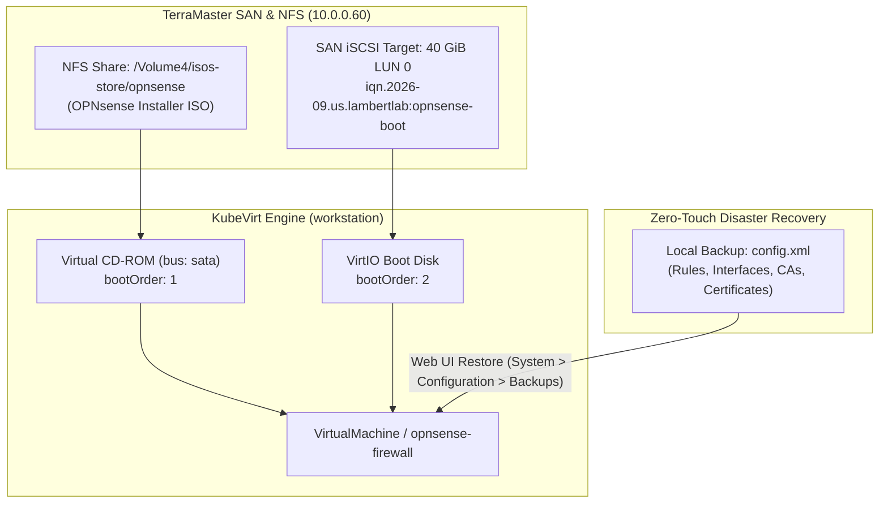

# Runbook: OPNsense KubeVirt ISO Bootstrap & State Recovery SOP

This Standard Operating Procedure (SOP) documents the initial provisioning, CD-ROM ISO bootstrapping, and declarative state restoration for the **OPNsense** virtual edge firewall hosted on **KubeVirt** with TerraMaster SAN iSCSI block storage.

---

## 🏗️ Architecture & Storage Layout

The OPNsense virtual machine runs bare-metal virtualization on the `workstation` compute node, backed by a dedicated 40 GiB raw iSCSI block LUN (`iqn.2026-09.us.lambertlab:opnsense-boot`) on the TerraMaster SAN NVMe pool.



---

## 🛠️ Step 1: Attach CD-ROM Installer Drive

To boot the installer ISO, ensure the `VirtualMachine` manifest (`kubernetes/vms/opnsense/virtualmachine.yaml`) attaches the NFS installer PVC (`nas-isos-opnsense-pvc`) as a virtual CD-ROM with priority boot order:

```yaml
devices:
  disks:
    - name: cdrom-iso
      cdrom:
        bus: sata
      bootOrder: 1
    - name: boot-disk
      disk:
        bus: virtio
      bootOrder: 2
volumes:
  - name: cdrom-iso
    persistentVolumeClaim:
      claimName: nas-isos-opnsense-pvc
  - name: boot-disk
    persistentVolumeClaim:
      claimName: opnsense-boot-pvc
```

---

## 🚀 Step 2: Boot & Execute Guided Installation

1. Start the virtual machine:
   ```bash
   virtctl start opnsense-firewall -n vms
   ```

2. Attach to the graphical VNC or serial console:
   ```bash
   virtctl vnc opnsense-firewall -n vms
   # OR for text terminal:
   virtctl console opnsense-firewall -n vms
   ```

3. **In the Live Installer:**
   * Wait for the console prompt. Log in with the dedicated installer account:
     * **Username:** `installer`
     * **Password:** `opnsense`
   * Select **Keymap** (`Continue with default keymap`).
   * Choose **Install (ZFS)** or **Install (UFS)**:
     * Select **Guided Installation (UFS)** (optimal for single virtual block devices).
     * Choose the primary target: `vtbd0` (the 40 GiB VirtIO disk).
   * Confirm format and proceed. The automated file extraction completes in **45–60 seconds**.
   * When prompted, choose **Reboot**.

---

## 🔄 Step 3: Complete State Restoration via `config.xml`

OPNsense maintains its complete state (VLANs, firewall rules, NAT, DHCP reservations, Unbound DNS, syslog targets, CAs, and SSL/TLS certificates) in a single declarative XML file (`config.xml`).

1. Once the VM boots into the base system, log into the web interface:
   * URL: `https://10.0.0.1` (or assigned LAN/WAN IP).
   * Default credentials: `root` / `opnsense`.
2. Navigate to **System > Configuration > Backups**.
3. Under **Restore Backup**:
   * Click **Browse / Choose File** and select your saved `config.xml`.
   * Click **Restore Configuration**.
4. The system will prompt to reboot. Upon rebooting:
   * All interfaces, static routes, and network policies are 100% active.
   * All certificates, CAs, and ACME credentials are restored with zero manual intervention.

---

## 🧹 Step 4: Detach Installer CD-ROM (Post-Install)

Once installation and verification are complete, detach the CD-ROM drive from `kubernetes/vms/opnsense/virtualmachine.yaml` so the VM boots directly from `boot-disk`:

```yaml
devices:
  disks:
    - name: boot-disk
      disk:
        bus: virtio
      bootOrder: 1
volumes:
  - name: boot-disk
    persistentVolumeClaim:
      claimName: opnsense-boot-pvc
```

Push the commit to Git, and ArgoCD will automatically reconcile the declarative manifest.
