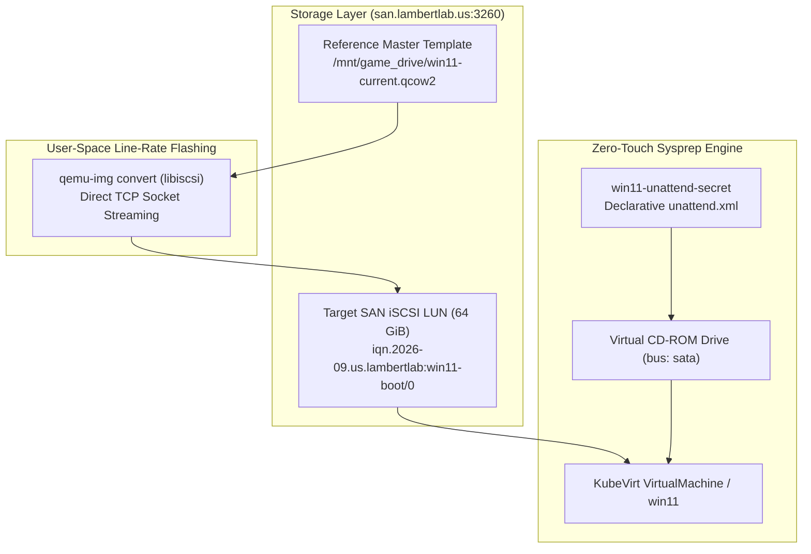

# Runbook: Windows 11 Workstation Provisioning & Sysprep Automation SOP

This Standard Operating Procedure (SOP) documents the enterprise provisioning lifecycle for Windows 11 virtual workstations on **KubeVirt** with direct **TerraMaster SAN iSCSI** block storage, line-rate template flashing, and zero-touch **Microsoft Sysprep specialization**.

---

## 🏗️ Architecture & Storage Overview

Virtual workstations run on KubeVirt compute nodes backed by dedicated SAN block targets (`iscsi://san.lambertlab.us/iqn.2026-09.us.lambertlab:win11-boot/0`) on the high-speed NVMe storage pool.



---

## ⚡ Step 1: Direct Line-Rate SAN Flashing

Bypassing the Kubernetes CDI upload proxy prevents HTTP idle timeouts and eliminates 64 GB host scratch volume allocations. Using user-space `libiscsi`, write the reference image directly to the SAN LUN:

```bash
sudo qemu-img convert -p -f qcow2 -O raw \
  /mnt/game_drive/tmp_migration/win11-current.qcow2 \
  iscsi://10.0.0.60/iqn.2026-09.us.lambertlab:win11-boot/0
```

---

## 📜 Step 2: Declarative Sysprep `unattend.xml` Specification

Windows 11 specializes on first boot using an unattended answer file mounted via Kubernetes Secret (`win11-unattend-secret`).

### Answer File Mechanics (`unattend.xml.example`)

```xml
<?xml version="1.0" encoding="utf-8"?>
<unattend xmlns="urn:schemas-microsoft-com:unattend" xmlns:wcm="http://schemas.microsoft.com/WMIConfig/2002/State">

  <!-- ================================================================= -->
  <!-- 1. SPECIALIZE PASS (DNS -> Identity -> Automated Domain Join)     -->
  <!-- ================================================================= -->
  <settings pass="specialize">

    <!-- 1. Ensure DNS points directly to Domain Controller for SRV discovery -->
    <component name="Microsoft-Windows-Deployment" processorArchitecture="amd64" publicKeyToken="31bf3856ad364e35" language="neutral" versionScope="nonSxS">
      <RunSynchronous>
        <RunSynchronousCommand wcm:action="add">
          <Order>1</Order>
          <Path>powershell.exe -ExecutionPolicy Bypass -Command "Get-NetAdapter | Where-Object Status -eq 'Up' | Set-DnsClientServerAddress -ServerAddresses ('10.10.0.10')"</Path>
          <Description>Set DNS to Domain Controller</Description>
        </RunSynchronousCommand>
      </RunSynchronous>
    </component>

    <!-- 2. Dynamic Unique Hostname (* = WIN-XXXXXXXX) and TimeZone -->
    <component name="Microsoft-Windows-Shell-Setup" processorArchitecture="amd64" publicKeyToken="31bf3856ad364e35" language="neutral" versionScope="nonSxS">
      <ComputerName>*</ComputerName>
      <TimeZone>Eastern Standard Time</TimeZone>
    </component>

    <!-- 3. Automated Domain Join via Least-Privilege Service Account -->
    <component name="Microsoft-Windows-UnattendedJoin" processorArchitecture="amd64" publicKeyToken="31bf3856ad364e35" language="neutral" versionScope="nonSxS">
      <Identification>
        <Credentials>
          <Domain>ad.lambertlab.us</Domain>
          <Username>svc_domainjoin</Username>
          <Password>{{ VAULT_AD_DOMAIN_JOIN_PASSWORD }}</Password>
        </Credentials>
        <JoinDomain>ad.lambertlab.us</JoinDomain>
        <MachineObjectOU>OU=Desktops,OU=LambertLab,DC=ad,DC=lambertlab,DC=us</MachineObjectOU>
      </Identification>
    </component>

  </settings>

  <!-- ================================================================= -->
  <!-- 2. OOBESYSTEM PASS (Regional Bypass -> LAPS Admin -> WinRM)       -->
  <!-- ================================================================= -->
  <settings pass="oobeSystem">

    <!-- Automate Country/Region and Keyboard Layout (Suppresses OOBE prompts) -->
    <component name="Microsoft-Windows-International-Core" processorArchitecture="amd64" publicKeyToken="31bf3856ad364e35" language="neutral" versionScope="nonSxS">
      <InputLocale>0409:00000409</InputLocale>
      <SystemLocale>en-US</SystemLocale>
      <UILanguage>en-US</UILanguage>
      <UserLocale>en-US</UserLocale>
    </component>

    <component name="Microsoft-Windows-Shell-Setup" processorArchitecture="amd64" publicKeyToken="31bf3856ad364e35" language="neutral" versionScope="nonSxS">

      <!-- Provision Dedicated LAPS Local Administrator -->
      <UserAccounts>
        <LocalAccounts>
          <LocalAccount wcm:action="add">
            <Name>lapsadmin</Name>
            <DisplayName>LAPS Local Administrator</DisplayName>
            <Description>Dedicated LAPS Managed Administrator</Description>
            <Group>Administrators</Group>
            <Password>
              <Value>{{ VAULT_LAPS_INITIAL_PASSWORD }}</Value>
              <PlainText>true</PlainText>
            </Password>
          </LocalAccount>
        </LocalAccounts>
      </UserAccounts>

      <!-- Suppress all consumer setup screens -->
      <OOBE>
        <HideEULAPage>true</HideEULAPage>
        <HideLocalAccountScreen>true</HideLocalAccountScreen>
        <HideOEMRegistrationScreen>true</HideOEMRegistrationScreen>
        <HideOnlineAccountScreens>true</HideOnlineAccountScreens>
        <HideWirelessSetupInOOBE>true</HideWirelessSetupInOOBE>
        <ProtectYourPC>3</ProtectYourPC>
        <NetworkLocation>Work</NetworkLocation>
      </OOBE>

      <!-- Enable PowerShell Remoting / WinRM for Ansible & Automation -->
      <FirstLogonCommands>
        <SynchronousCommand wcm:action="add">
          <Order>1</Order>
          <CommandLine>powershell.exe -ExecutionPolicy Bypass -Command "Enable-PSRemoting -Force"</CommandLine>
          <Description>Enable WinRM</Description>
        </SynchronousCommand>
      </FirstLogonCommands>

    </component>

  </settings>

</unattend>
```

---

## 🚀 Step 3: Boot & Post-Specialization Verification

1. Start the virtual machine:
   ```bash
   virtctl start win11 -n vms
   ```

2. Monitor specialization progress:
   ```bash
   virtctl vnc win11 -n vms
   ```

3. **Verification Checklist:**
   - **Computer Name:** Confirm generated hostname matches `WIN-*`.
   - **Domain Join:** Verify machine object created under `OU=Desktops,OU=LambertLab,DC=ad,DC=lambertlab,DC=us`.
   - **LAPS:** Verify local administrator account `lapsadmin` is active.
   - **WinRM:** Test remote PowerShell connectivity over port 5985/5986.
